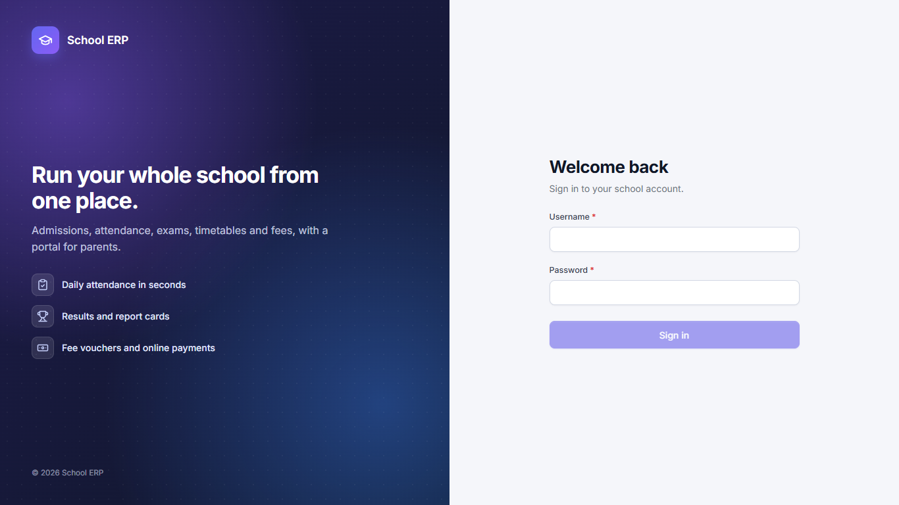
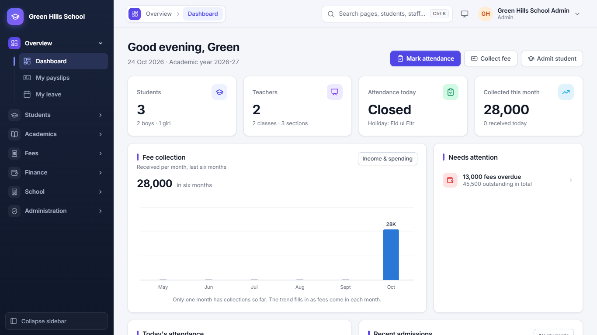

[User Guide](README.md) › Login and Dashboard

# Login and Dashboard

## Login

1. Open the app's address in your browser. The login page opens.
2. Type your **Username** and **Password**. You do not need a school code: every username is used only once in the
   whole app.
3. Click **Sign in**. Staff go to the Dashboard. Parents go to the Portal.
4. The first time you sign in, or after your password is reset, you must choose a new password.

If you type the wrong password many times, login stops for a few minutes. If you forget your password, ask the Admin
to reset it.

## Dashboard

The Dashboard is the first page after login. It shows the school's day at a glance:

- **Four cards at the top:** number of Students, Teachers, Attendance today (shows *Closed* on a holiday) and fees
  Collected this month.
- **Fee collection:** how much fee came in each month for the last six months.
- **Needs attention:** things to look at now, like overdue fees or transfer proofs waiting to be checked. Click a line
  to open that page.
- **Three quick buttons** at the top right: Mark attendance, Collect fee and Admit student.
- Lower down: **Today's attendance** and **Recent admissions**.

---

Next: [Different logins](02-logins.md)
