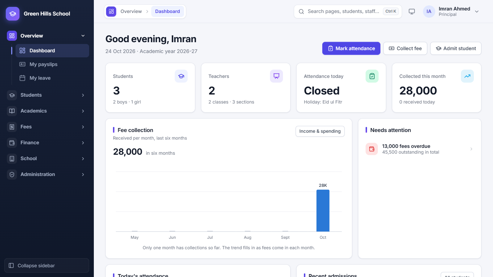
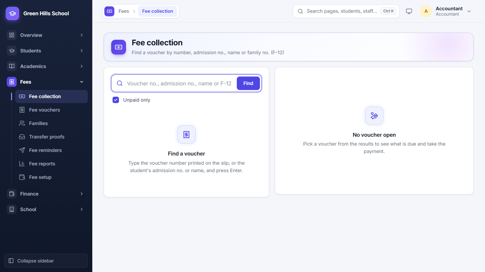
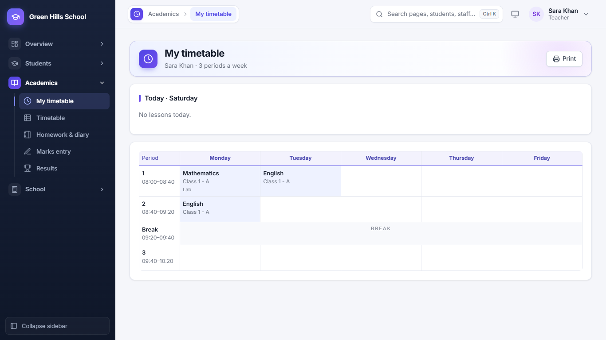

[User Guide](README.md) › Different logins

# Different Logins

Every person signs in on the same login page. What they see next depends on their role: each role gets its own menu,
and pages outside it cannot be opened. Staff logins are made in **Administration → Users**; parent logins are made
from the student's page.

## Which pages each staff login sees

| Menu | Page | Admin / Principal | Accountant | Teacher |
| --- | --- | :---: | :---: | :---: |
| Overview | Dashboard, Notice board, My payslips, My leave | ✓ | ✓ | ✓ |
| Overview | Parent messages | ✓ all | ✓ fee office | ✓ sent to them |
| Students | Students (list) | ✓ | ✓ | ✓ |
| Students | Admission enquiries | ✓ | ✓ |  |
| Students | Attendance, Scan ID cards | ✓ |  | ✓ own sections (attendance) |
| Students | Monthly attendance | ✓ | ✓ | ✓ |
| Students | Attendance devices, Promote students, Certificates, ID cards | ✓ |  |  |
| Academics | My timetable |  |  | ✓ |
| Academics | Timetable, Results, Board exams, Library | ✓ | ✓ | ✓ |
| Academics | Homework & diary, Marks entry, Syllabus, Lesson plans | ✓ |  | ✓ own classes |
| Academics | Exams | ✓ |  |  |
| Fees | All fee pages (collection, vouchers, families, scholarships & installments, uniform & books, transfer proofs, reminders, reports, setup) | ✓ | ✓ |  |
| Finance | Payroll, Salaries, Salary advances, Expenses, Income & spending | ✓ | ✓ |  |
| School | Staff, Classes & sections, Subjects, Holidays | ✓ | ✓ | ✓ |
| School | Staff attendance by month | ✓ | ✓ |  |
| School | Staff attendance, Staff leave, Academic years | ✓ |  |  |
| Administration | Users, School profile, Audit log | ✓ |  |  |

## Admin and Principal

Admin and Principal see the same full menu and start on the Dashboard. They run the whole school: students, exams,
fees, payroll, staff, users and settings. Use Admin for the school owner or office head, and Principal for the head
teacher.

## Accountant

The Accountant starts on the Dashboard and works mostly in Fees and Finance: collecting fees, making vouchers, checking
transfer proofs, sending reminders, payroll and expenses. They can look at students, timetables and results, but
cannot mark attendance, enter marks, or open Users and the Audit log.

## Teacher

The Teacher starts on the Dashboard. **My timetable** shows their own lessons for the week and today. They mark
attendance, enter marks and post homework only for the classes and subjects given to them; other classes do not
appear. They have no Fees, Finance or Administration menu. Every staff login, including teachers, can see their own
payslips and ask for leave under Overview.

## Parent

A parent goes straight to the Portal (**My children**) and sees only their own children. See
[Parent Portal](09-parent-portal.md). One parent login can cover brothers and sisters. If the children study at
different branches of a School Group, the parent can switch between branches in the Portal.

## Owner (Super Admin)

The Owner has no school of their own. Their menu is **Schools**, **Integrations**, **Billing**, **Requests**,
**Packages** and **Website**: they add schools, give each school its first Admin login, switch schools on or off, make
School Groups, set each school's package and paid services, and bill the schools every month. See
[For the platform owner](12-platform-owner.md).

## Group login (several branches)

A group login can be an Admin, Principal or Accountant of the whole group. After sign-in it opens the group pages
(All branches, Fees across branches, Branch transfers; Group sign-ins for Admin only). Pick a branch at the top of the
sidebar to work inside it with that role's normal menu. See [School Groups](08-school-groups.md).

## Good practice

- Give each person their own login. Do not share one login: the Audit log then shows who did what.
- When someone leaves, switch their login off in Users.
- Everyone must change the temporary password at first sign-in.

---

Previous: [Login and Dashboard](01-login-and-dashboard.md) · Next: [Students](03-students.md)
