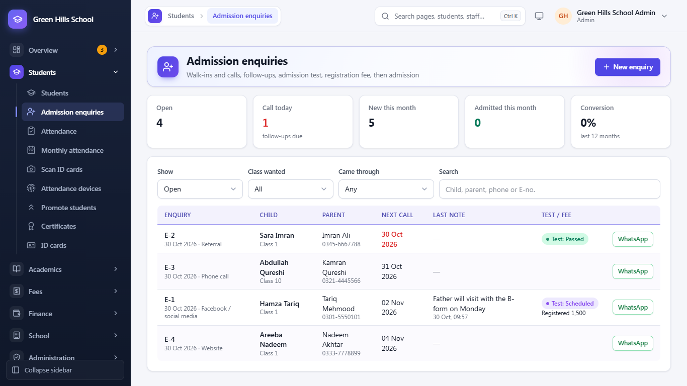
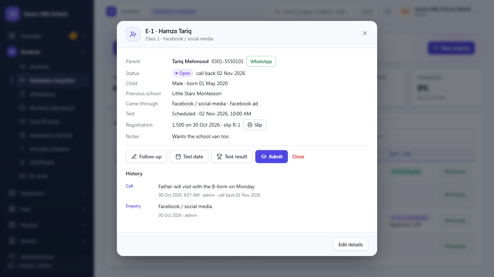
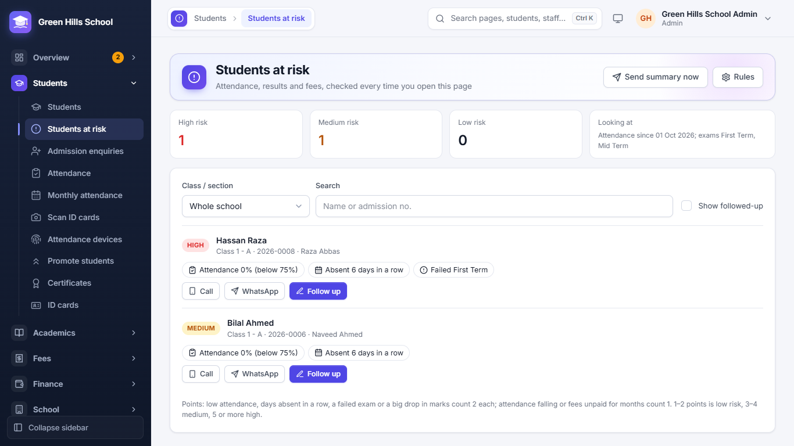

[User Guide](README.md) › Students

# Students

## Student list

Open **Students → Students**. You see every student with Adm. No., Name, Class, Roll, Guardian, Phone, Admitted date
and Status.

- Search by name, admission no., guardian or phone. Use **Class / section** and **Status** (Active, Left, Struck off)
  to narrow the list.
- Click a column heading to sort the list by that column.
- **Saved views:** save filters you use often. Admin and Principal can share them with other staff.
- The **Excel** button downloads the list as an Excel file.

## Admission enquiries

Open **Students → Admission enquiries** (Admin, Principal and Accountant). Every walk-in or phone call about admission
is written here, so no interested parent is forgotten. The cards at the top show how many are **Open**, how many to
**Call today**, the enquiries **New this month** and **Admitted this month**, and the **Conversion** (how many
enquiries became students in the last 12 months). Click **Open**, **Call today** or **Admitted this month** to list those enquiries; filter by **Class wanted**
and **Came through**, or search a name, phone or E-no.

**Add an enquiry**

1. Click **New enquiry**.
2. Enter the **Child's name**, gender, date of birth (if known), the **Class wanted**, the **Parent's name** and
   **Phone**, and how the parent heard of the school (**Came through**: walk-in, phone, social media, referral, website
   or other). Previous school, address and notes are optional.
3. Set **Call back on** if you promised to call the parent, then **Save**. The enquiry gets a number like E-4.

Click an enquiry to open it. The buttons there follow the usual steps:

- **Follow-up:** write **What was said** on each call or visit, and the next **Call back on** date. The list shows
  who to call today first. **WhatsApp** opens a chat with the parent's number.
- **Test date** and **Test result:** set the admission test or interview, then record Passed, Failed or Absent with
  marks or remarks.
- **Registration fee:** enter the amount and click **Receive and print slip**. The slip gets its own number (like R-2).
  This fee is kept on the enquiry; it is not part of the monthly fee collections.
- **Admit:** opens **Admit student** with the child's and parent's details already filled in. When you save, the
  enquiry shows **Admitted** and links to the new student.
- **Close:** the parent is not joining. Write the reason. A closed enquiry can be **Reopened** later.

## Admit a new student

1. In Students, click **Admit student** (or **Admit** on an admission enquiry, which fills in the details for you).
2. **Admission:** leave Admission no. empty and the next number is used (for example 2026-0007). Fill in Admission
   date, Class / section and Roll no.
3. **Student:** name, Gender, Date of birth, B-Form no. and Blood group. Click **Upload** to add a photo; the app crops
   it to passport size.
4. **Guardian:** name, Relation, Phone and Address. Type the phone number carefully: fee reminders and absence SMS go
   to this number.
5. If this phone already belongs to a family, the app asks if the child should join that family (for example F-12).
6. Click **Save**.

## Add many students from Excel (Import from Excel)

1. In Students, click **Import from Excel** and download the **Template**. Its Classes sheet lists the exact class
   names of your school.
2. Fill in the template and upload it (.xlsx or .csv).
3. The **Preview** checks every row. Problems like a wrong date, a repeated row or a full class are shown in red.
4. Fix the problems, or skip the bad rows and import the rest.

## A student's page

Click a student in the list to open their full record. Change any detail and click **Save**. Buttons at the top:

- **Strike off:** remove a student who does not pay or stops coming. When they come back, **Readmit** them; a
  readmission fee can be charged.
- **ID card:** make this student's ID card.
- **Issue certificate:** School Leaving, Character or Bonafide certificate.
- **Audit log:** who changed what in this record, and when.

The parent's **Portal login** is also made from this page. The guardian's mobile number becomes the username, and the
app gives a temporary password. The parent must change it at first login. One login can be linked to brothers and
sisters.

## Students at risk

**Students → Students at risk** finds children who may drop out or fail, before it is too late. Every time the page
opens, the app looks at each student's attendance, exam results and fees and gives points:

- **2 points each:** attendance below the limit (75% to start with), absent several days in a row, failed an exam, or
  a big drop in marks since the last exam.
- **1 point each:** attendance falling compared with the weeks before, or fees unpaid for months.

1–2 points is **Low**, 3–4 **Medium** and 5 or more **High** risk. Each student shows the reasons as small chips, and
the counts at the top show how many are at each level. Choose a class / section or search by name.

- **Call** and **WhatsApp** open the guardian's number on a phone.
- **Follow up** writes what was done ("Spoke to the father, child was ill") and can hide the student for a week, two
  weeks or a month. Tick **Show followed-up** to see them again; earlier follow-ups stay on the student.
- **Rules** (Admin and Principal) changes the limits: how many days to look back, the attendance % that is too low,
  how far it must fall, how many days absent in a row, how big a marks drop counts, and after how many months unpaid
  fees count (0 ignores fees).
- **Morning summary:** in Rules, tick **Send the principal a summary every school day**, choose the time and up to 3
  mobile numbers. It goes by WhatsApp or SMS (as the school sends its automatic messages) and as an app
  notification to Admin and Principal logins, only when someone is at medium or high risk. **Send summary now** sends
  it straight away.

The Admin and Principal see the whole school; a teacher sees only the sections where they are the class teacher. The
Dashboard's **Needs attention** box shows how many students are at medium or high risk.

## ID Cards

Open **Students → ID cards**. Choose a class, tick the students and click **Print**. Ten cards fit on one A4 page. Each
card has the photo, blood group, school logo and a QR code. Staff cards are made here too. Scanning the card's QR code
marks attendance: see [Scan ID cards](04-attendance-and-holidays.md#scan-id-cards).

---

Previous: [Different logins](02-logins.md) · Next: [Attendance and Holidays](04-attendance-and-holidays.md)
