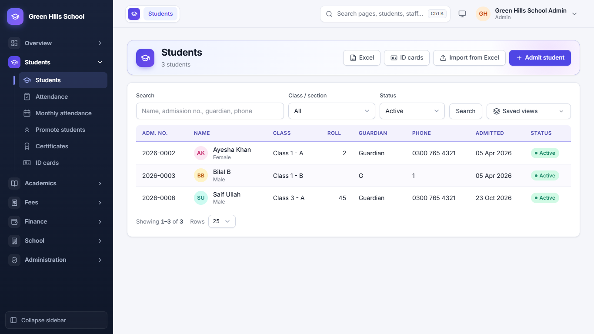
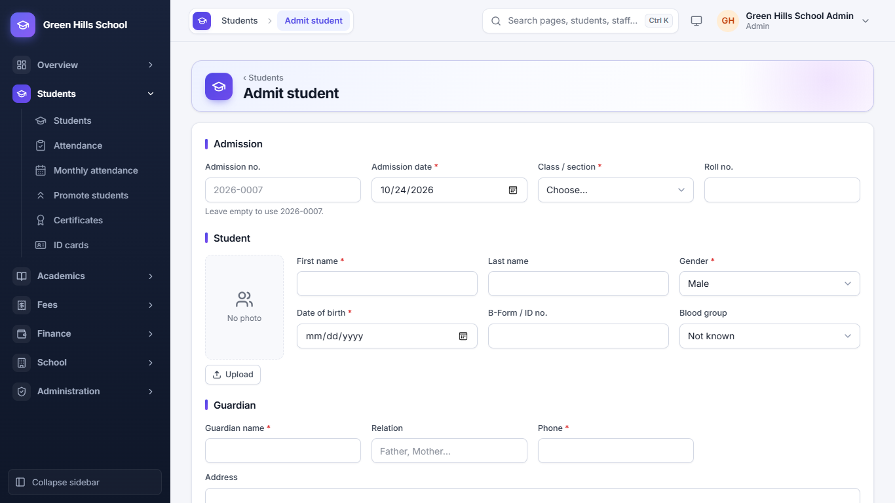
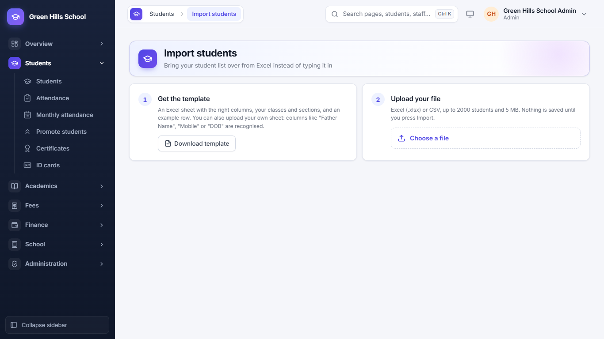
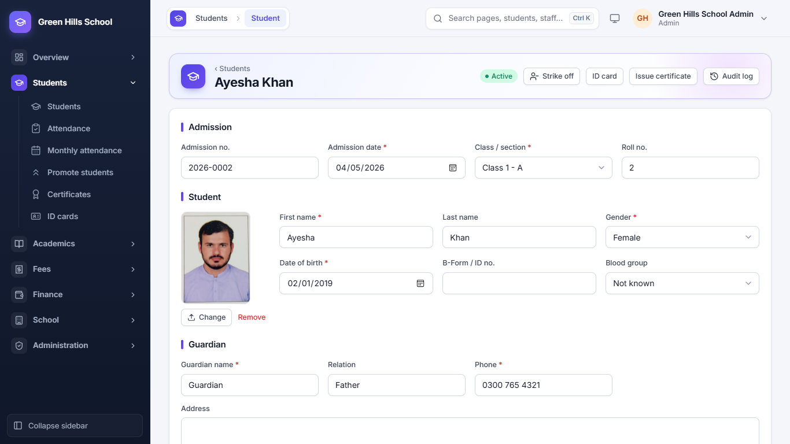
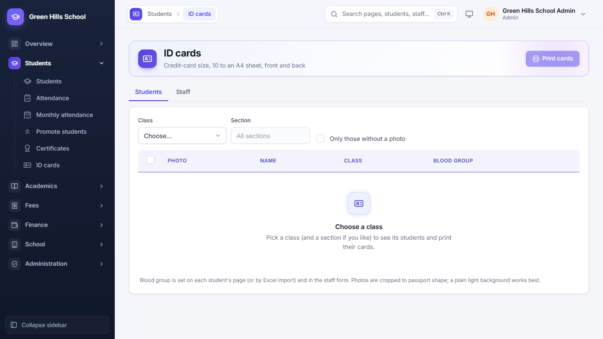

[User Guide](README.md) › Students

# Students

## Student list

Open **Students → Students**. You see every student with Adm. No., Name, Class, Roll, Guardian, Phone, Admitted date
and Status.

- Search by name, admission no., guardian or phone. Use **Class / section** and **Status** (Active, Left, Struck off)
  to narrow the list.
- Click a column heading to sort the list by that column.
- **Saved views:** save filters you use often. Admin and Principal can share them with other staff.
- The **Excel** button downloads the list as an Excel file.

## Admit a new student

1. In Students, click **Admit student**.
2. **Admission:** leave Admission no. empty and the next number is used (for example 2026-0007). Fill in Admission
   date, Class / section and Roll no.
3. **Student:** name, Gender, Date of birth, B-Form no. and Blood group. Click **Upload** to add a photo; the app crops
   it to passport size.
4. **Guardian:** name, Relation, Phone and Address. Type the phone number carefully: fee reminders and absence SMS go
   to this number.
5. If this phone already belongs to a family, the app asks if the child should join that family (for example F-12).
6. Click **Save**.

## Add many students from Excel (Import from Excel)

1. In Students, click **Import from Excel** and download the **Template**. Its Classes sheet lists the exact class
   names of your school.
2. Fill in the template and upload it (.xlsx or .csv).
3. The **Preview** checks every row. Problems like a wrong date, a repeated row or a full class are shown in red.
4. Fix the problems, or skip the bad rows and import the rest.

## A student's page

Click a student in the list to open their full record. Change any detail and click **Save**. Buttons at the top:

- **Strike off:** remove a student who does not pay or stops coming. When they come back, **Readmit** them; a
  readmission fee can be charged.
- **ID card:** make this student's ID card.
- **Issue certificate:** School Leaving, Character or Bonafide certificate.
- **Audit log:** who changed what in this record, and when.

The parent's **Portal login** is also made from this page. The guardian's mobile number becomes the username, and the
app gives a temporary password. The parent must change it at first login. One login can be linked to brothers and
sisters.

## ID Cards

Open **Students → ID cards**. Choose a class, tick the students and click **Print**. Ten cards fit on one A4 page. Each
card has the photo, blood group, school logo and a QR code. Staff cards are made here too.

---

Previous: [Different logins](02-logins.md) · Next: [Attendance and Holidays](04-attendance-and-holidays.md)
