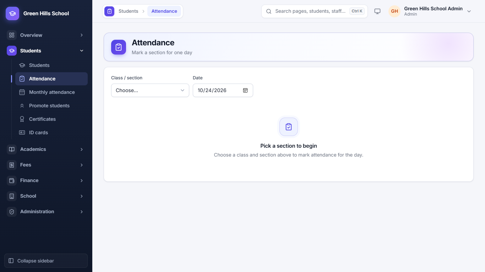
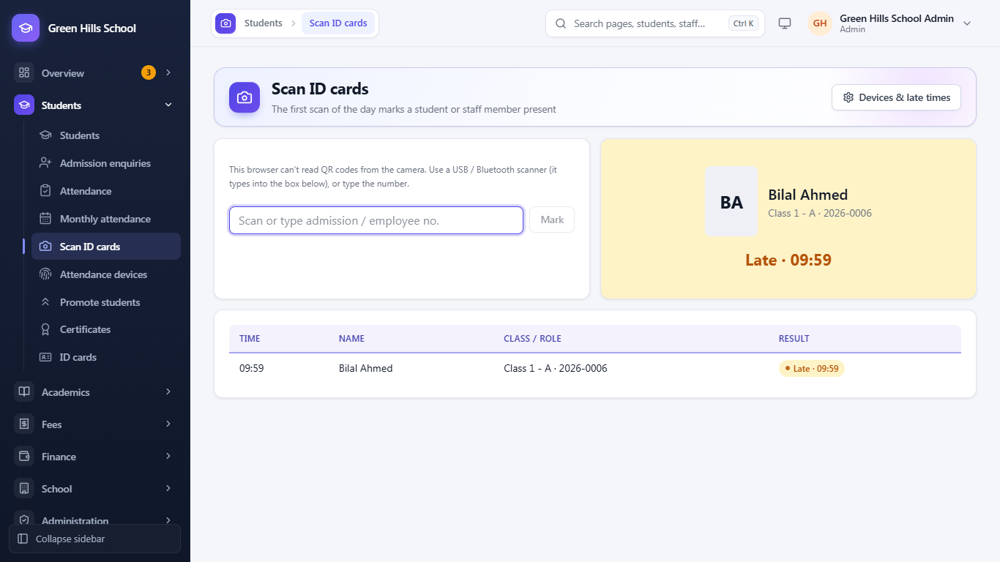
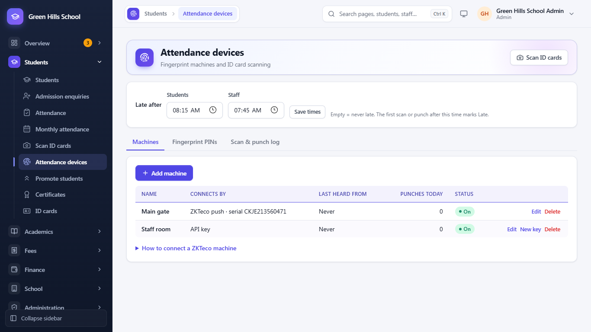
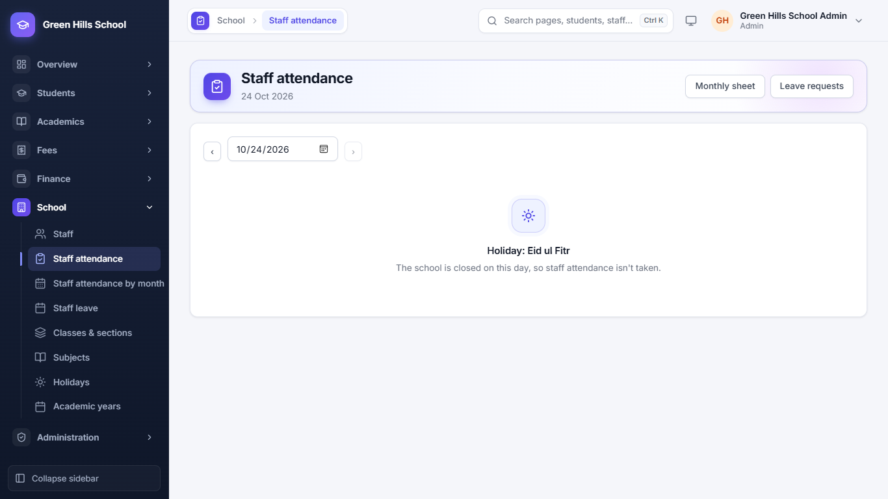
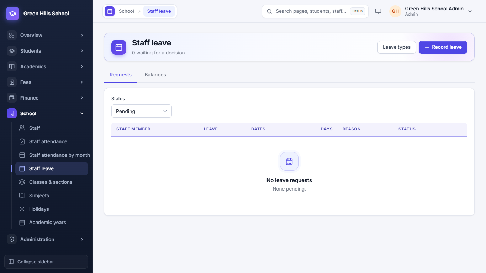
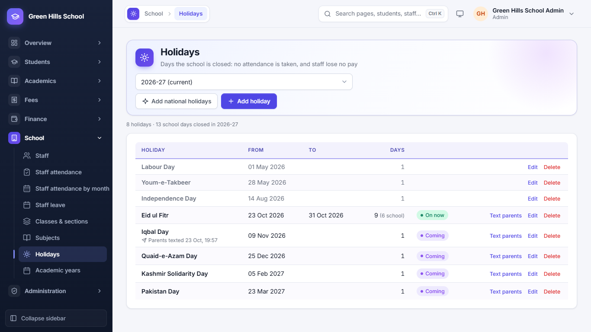

[User Guide](README.md) › Attendance and Holidays

# Attendance and Holidays

## Daily student attendance

1. Open **Students → Attendance**.
2. Choose the **Class / section** and the **Date**. All students of that section appear.
3. Mark each student Present, Absent, Late or Leave, then click **Save**.

Parents of absent students get a message 15 minutes later: by SMS, WhatsApp, or WhatsApp with SMS as the fallback, as
set in the [School profile](10-settings-and-faq.md#messages-to-parents). If you correct a mistake before then, no
message is sent. A teacher can mark only their own sections. Attendance cannot be taken on a holiday.

## Scan ID cards

Instead of ticking names, students and staff can show their ID card at the gate. Open **Students → Scan ID cards**
(Admin, Principal and Teacher).

- On a phone or tablet the camera reads the card's QR code. On a computer, plug in a USB or Bluetooth barcode scanner:
  it types the number into the box and presses Enter by itself. You can also type the admission no. or employee no.
- The first scan of the day marks the person **Present**, or **Late** after the late time. A student already marked
  absent is corrected to present, and the absence message is not sent.
- A second scan the same day (for example going home) is only logged. Scans on a holiday or weekend are refused.
- Teachers scan student cards; staff cards are scanned by the Principal or Admin.

The page shows each result in large letters (name, class and what happened) and a list of recent scans.

## Fingerprint machines

**Students → Attendance devices** (Admin and Principal) connects fingerprint or face machines, so attendance is marked
when a student or teacher punches in. At the top, set the **late times** for students and for staff and click **Save
times**; the first scan or punch after that time marks Late (empty = never late). Below are three tabs:

- **Machines:** click **Add machine**. For a ZKTeco machine choose **ZKTeco push (ADMS)** and enter its **Serial
  number** (on the machine: Menu › System Info). Then on the machine open Menu › Comm. › Cloud Server Setting (ADMS)
  and enter the server address shown on the page. Other machines, or a sync program, use an **API key** instead: it is
  shown only once, so copy it straight away (**New key** makes another). **Last heard from** shows that the machine is
  connected.
- **Fingerprint PINs:** every student and staff member needs a PIN, the number they are enrolled under on the machine.
  **Give everyone a PIN** fills in the missing ones (staff from 1, students from 1001). You can change a PIN and
  **Save PINs**.
- **Scan & punch log:** every card scan and machine punch of a day, with the person, the time and the result. Tick
  **Unknown PINs only** to find people enrolled under a PIN that is not in the app.

A punch works like a card scan: the first one of the day marks Present or Late.

## Monthly attendance

**Students → Monthly attendance** shows one section's whole month in a grid, with each student's total present and
absent days. You can download it as Excel.

## Staff attendance

Staff can also be marked present by scanning their ID card or with a fingerprint machine (see above).

In **School → Staff attendance**, mark staff Present, Absent, Half day or Leave each day. Absent and Half day without
approved leave are cut from pay in Payroll automatically (Absent = 1 day, Half day = half a day).
**Staff attendance by month** shows the month's summary.

## Staff leave

In **School → Staff leave**, approve or reject leave requests. Each year staff get Casual 10 and Sick 10 days.
*Without pay* leave has no limit, but those days are cut from pay. Staff can send their own request from **My leave**.

## Holidays

In **School → Holidays**, enter the days the school is closed. No attendance is taken on those days, and staff lose no
pay.

- **Add national holidays:** adds the 7 fixed national holidays (like Labour Day, Independence Day, Quaid-e-Azam Day)
  in one click. Eid and Muharram dates change each year, so add them yourself with **Add holiday**.
- **Text parents:** send an SMS about the holiday to all parents. The app offers this by itself when you add a holiday
  that starts within 7 days.
- If an exam paper, fee due date or homework due date falls on a holiday, the app warns you.

---

Previous: [Students](03-students.md) · Next: [Fees](05-fees.md)
