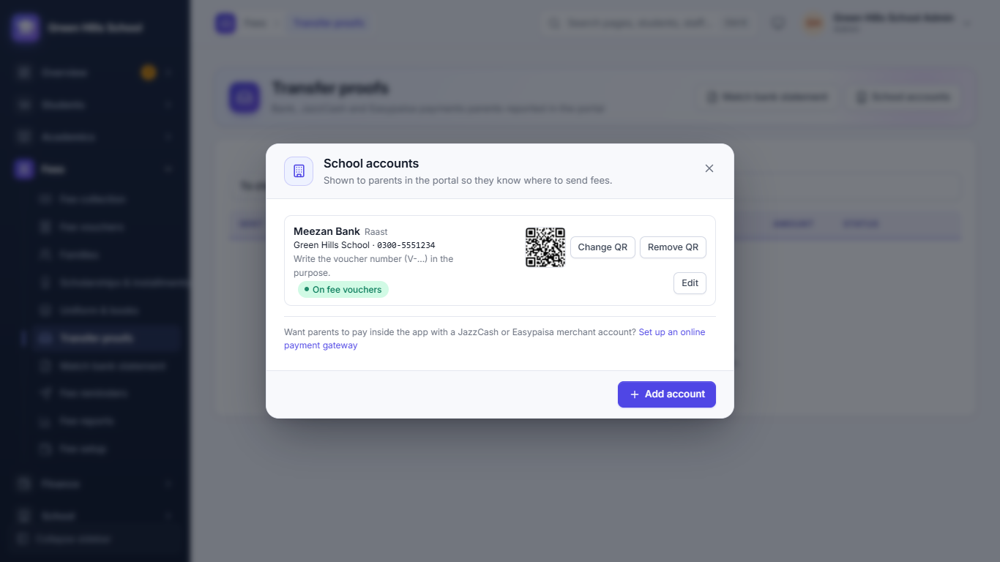
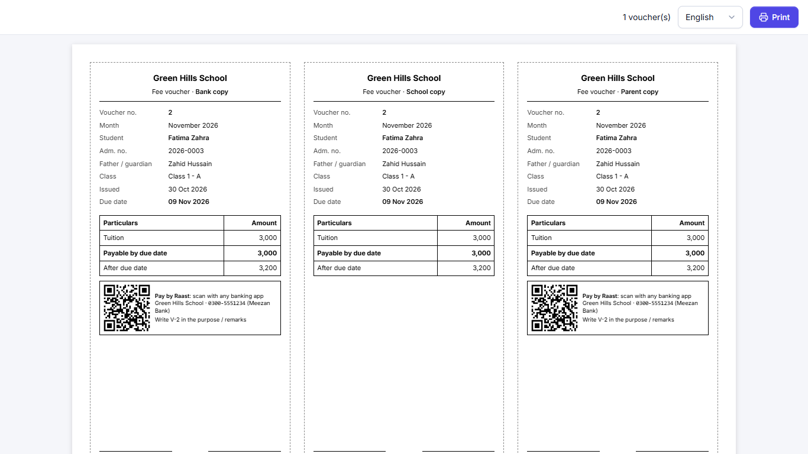
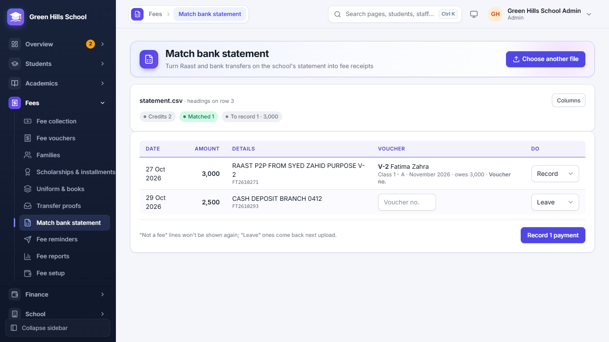
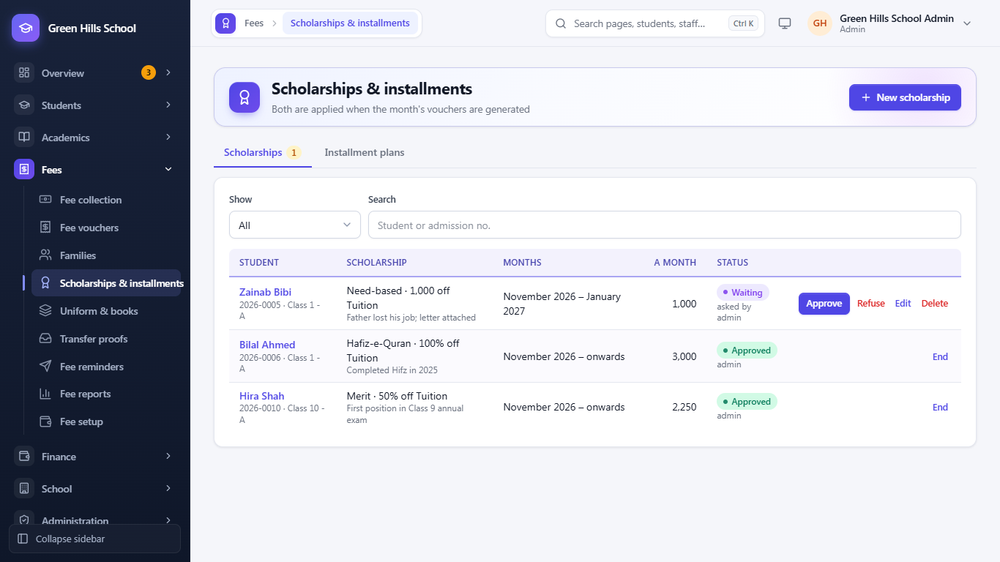
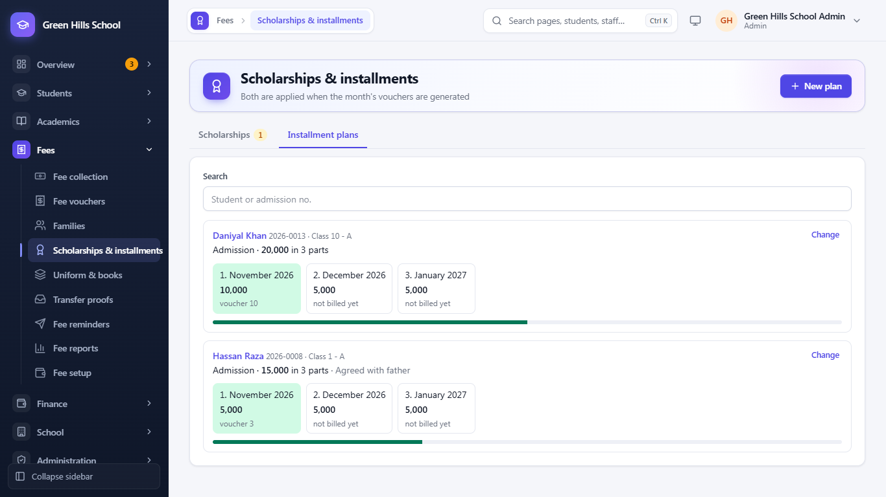
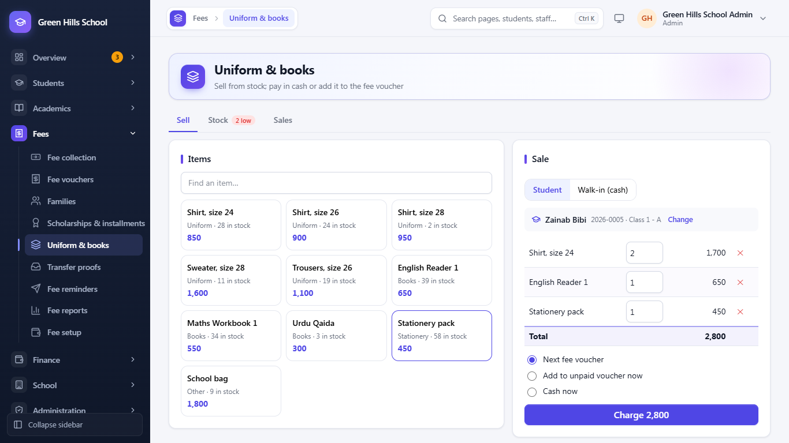

[User Guide](README.md) › Fees

# Fees

The usual monthly order is: set fees once (**Fee setup**) → make the month's vouchers → take payments at the counter
or from transfer proofs → send reminders to those who have not paid.

## Fee setup

Open **Fees → Fee setup**. It has three tabs:

- **Fee heads:** the kinds of fee, like Tuition (monthly), Computer (monthly) or Admission (one-time). The app adds
  some heads by itself when first needed: **Transport** with the first van route, **Library fine** with the first
  library fine (see [Transport and Library](11-transport-library-notices.md)), **Board fee** with the first board exam
  and **Uniform & books** with the first sale charged to fees.
- **Fee structure:** how much each class pays for each head in the academic year. Leave a box empty if a class does
  not pay that head. Click **Save fees**. New amounts apply only to vouchers made after saving.
- **Sibling discount:** younger brothers and sisters pay less. For example, the 2nd child gets 20% off tuition. If a
  child also has their own concession, the bigger one is used, not both.

## Fee vouchers

**Fees → Fee vouchers** shows one month's vouchers. The cards at the top show the number of Vouchers, Billed,
Collected and Outstanding. Each row shows the voucher no., student, due date, payable, paid, balance and status (like
Paid, Unpaid or Cancelled). Tick several vouchers to cancel them together or send reminders to them. **Print these**
prints the vouchers in the list.

## Make the month's vouchers (Generate vouchers)

1. In Fee vouchers, click **Generate vouchers**.
2. Choose the **Month to bill** and the **Students** (whole school or one class).
3. Tick the fee heads to bill. Monthly heads are ticked already.
4. Enter the **Issue date**, **Due date** and **Late fine**. If the due date is not a school day, the app suggests the
   next school day.
5. Click **Generate**. Students who already have a voucher for that month are skipped, so it is safe to run again after
   new admissions.

Some charges go on the voucher by themselves even if their head is not ticked: an installment part due that month, an
unpaid board fee, library fines and uniform or book sales charged to fees. Approved scholarships lower the fee.
If a voucher is cancelled, these charges go on the next voucher made for the student.

**Family vouchers** prints all brothers' and sisters' vouchers of one family on one slip.

## Take a payment at the counter (Fee collection)

1. Open **Fees → Fee collection**.
2. Type the voucher no. printed on the slip, the admission no., the student's name or the family no. (like F-12), then
   press Enter.
3. Pick the voucher. The right side shows what is due today, including any late fine.
4. Enter the amount received and save. Print the receipt.

If you type a family no., one payment is shared across all the children's vouchers, oldest due first. The family gets
one receipt (like FR-7).

## Families

**Fees → Families** groups brothers and sisters. Click **Find brothers and sisters**: the app suggests children who
share the same guardian mobile number. Each family gets a number like F-12. **Statement** prints a family's full fee
record for the year.

## Transfer proofs

Many parents pay by bank transfer, JazzCash or Easypaisa. They send the transaction ID and a photo of the receipt from
the Portal. In **Fees → Transfer proofs**:

- **Approve:** the payment is saved on the voucher, with the transaction ID as the reference.
- **Reject:** write the reason; the parent sees it.

The parent gets an SMS either way. A red badge in the menu shows how many proofs are waiting. The school's bank and
wallet accounts are entered by the Admin or Principal with the **School accounts** button on this page.

## Raast QR on vouchers

Raast lets a parent pay from any bank or wallet app by scanning a QR code, for free. Get the school's Raast QR from
your bank (it is the QR the bank gives for the school's account or Raast ID), then:

1. In **Fees → Transfer proofs**, click **School accounts** and add the account with the type **Raast** (or edit the
   bank account the QR belongs to).
2. Click **Add QR** and choose the picture of the bank's QR code.
3. Tick **Print on fee vouchers**. Only one account can be on the vouchers.

Every printed voucher that still has something to pay now has a **Pay by Raast** box on the bank and parent copies:
the QR code, the account number, and "Write V-123 in the purpose / remarks", with that voucher's own number. The
parent portal shows the same QR when a parent chooses to pay by transfer. A parent who pays this way does not need to
send a proof: the payment is found on the bank statement (next section).

## Match the bank statement

**Fees → Match bank statement** turns the money that came into the school's account into fee receipts, without
typing them one by one.

1. Download the account statement from internet banking as **Excel or CSV** and click **Upload statement**. The app finds
   the heading row by itself; if it picks the wrong columns, fix them with **Columns**.
2. Only money coming in (credits) is listed. For each line the app looks for the voucher: first "V-123" or
   "Voucher 123" in the details, then the admission no., then the amount together with the student's full name. It
   never matches on the amount alone.
3. Check each match. Type a **Voucher no.** for a line the app could not match. In **Do**, choose **Record**,
   **Leave** (it comes back next time you upload) or **Not a fee** (never shown again).
4. Click **Record payments** (it says how many, like "Record 3 payments"). Each one is saved as a bank payment on its voucher. If the parent had already sent a
   proof for the same voucher and amount, that proof is approved instead.

Lines that were already recorded are skipped if the same statement is uploaded again. A payment bigger than what the
voucher owes is refused, so the extra is not lost.

## Scholarships and installments

Open **Fees → Scholarships & installments**. Both are used when the month's vouchers are generated.

**Scholarships**

1. Click **New scholarship** and pick the student.
2. Choose the **Kind** (Merit, Need based, Sports, Hafiz-e-Quran, Orphan, Staff child or Other), the **Fee** it lowers
   (for example Tuition), and either a **Percent** off or a **Fixed amount** a month.
3. Enter the **From month**, and the **To month** if it ends (empty = until stopped), and the **Reason**.
4. Click **Ask for approval**. The Accountant can ask; only the Admin or Principal can **Approve** or **Refuse**.

An approved scholarship lowers every voucher from its first month. If the student also has a concession or a sibling
discount on the same fee, the bigger one is used, not both. **End** stops a scholarship: enter the last month it
applies.

**Installment plans** split a big fee, like the admission fee, into parts over several months.

1. On the **Installment plans** tab click **New plan** and pick the student.
2. Choose the **Fee**. The **Total** is filled in from the class's fee (less any concession); change it if needed.
3. Enter the number of **Parts** (2 to 12) and the **First month**. The app divides the total into monthly parts;
   change any part's month or amount if the parent agreed otherwise. The total of the parts is shown below them.
4. Click **Save plan**.

Each part goes on the voucher of its month, named like "Admission (2 of 4)", even if the fee head is not ticked when
generating. The plan card shows which parts are on which voucher and which are not billed yet. **Change** edits the
parts that are not on a voucher yet.

## Uniform & books

Schools that sell uniforms, books and stationery keep the stock and the sales in **Fees → Uniform & books** (Admin,
Principal and Accountant). It has three tabs.

**Stock:** click **Add item** for each thing you sell. Make one item per size (for example "Shirt, size 24") with its
**Price**, and set **Warn when stock is at or below**. Then:

- **Receive** when a delivery comes in: the pieces received, the cost per piece and the supplier (optional).
- **Count** when you count the shelf: enter the pieces there now and say why it differs (damaged, lost).
- **History** lists every change: received, sold, returned on a cancelled sale, counted.

Items running low show in red, and the Stock tab shows how many are low. An item that was ever stocked cannot be
deleted; untick **For sale** to hide it instead.

**Sell:**

1. Choose **Student** and pick the student, or **Walk-in (cash)** for someone else (the buyer's name is optional).
2. Tap the items on the left. Tap again to add one more, or change the quantity in the sale. The app does not let you
   sell more than is in stock.
3. For a student, choose how it is paid:
   - **Next fee voucher:** the sale goes on the next voucher generated, as "Uniform & books (S-12)".
   - **Add to unpaid voucher now:** pick one of the student's unpaid vouchers; the sale is added to it straight away.
   - **Cash now:** paid at the counter.
4. Click **Take** (cash) or **Charge**. A slip opens to print.

**Sales:** every sale between two dates, with the number of sales and the totals in cash and on fees. Each row shows
how it is paid ("Paid in cash", "Next fee voucher", "On voucher 123"). **Slip** prints it again. **Cancel** (with a
reason) puts the pieces back on the shelf. A sale that is already on a voucher can only be cancelled after cancelling
that voucher.

## Fee reminders

**Fees → Fee reminders** sends an SMS or WhatsApp message to parents who still owe fees. Check the preview first, then
send. Children of one family are joined into one message, so a parent does not get several texts.

Choose how to send: **SMS**, **WhatsApp**, or **WhatsApp, then SMS** (the choices depend on the message service the
school has set up). With the last one each reminder goes by WhatsApp first; if WhatsApp cannot deliver it (the number
is not on WhatsApp, or WhatsApp refuses it), the same text goes by SMS. The **Message** tab changes the wording, and the
**History** tab shows each message and how it went. The **WhatsApp** button next to a parent opens WhatsApp on this
computer or phone with the message typed in, ready to send yourself.

## Fee reports

**Fees → Fee reports** has two tabs. **Collections** lists every payment between two dates (From, To), with totals for
cash and online, and can be filtered by Method. **Defaulters** lists students who owe fees; you can filter by how many
months are unpaid, and managers can **Strike off** several defaulters at once. Use **Excel** or **Print** at the top
to download or print a report.

---

Previous: [Attendance and Holidays](04-attendance-and-holidays.md) · Next: [Exams, Timetable and more](06-academics.md)
