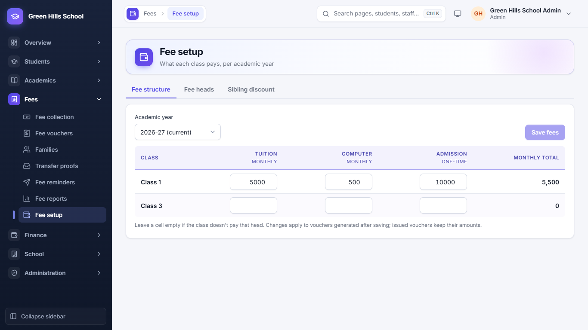
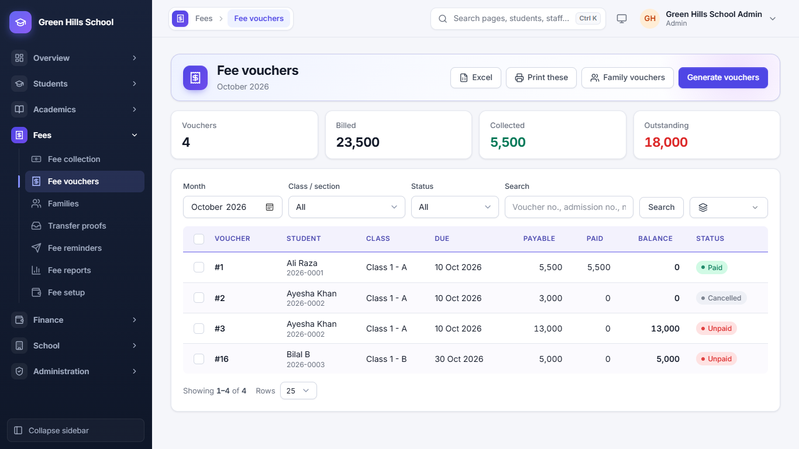
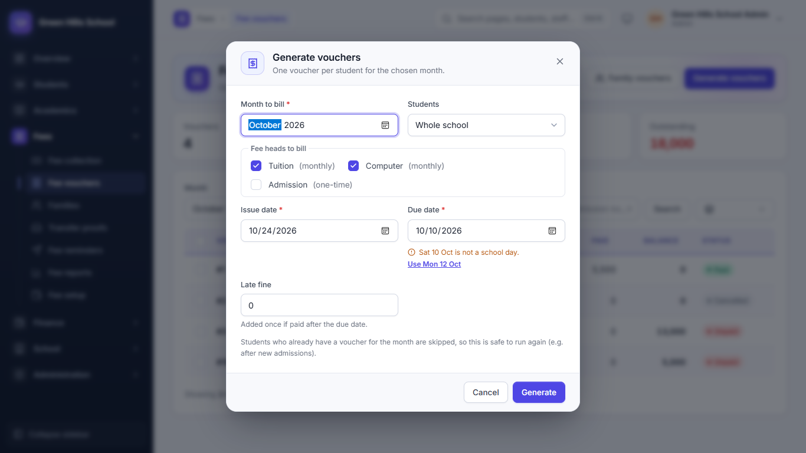
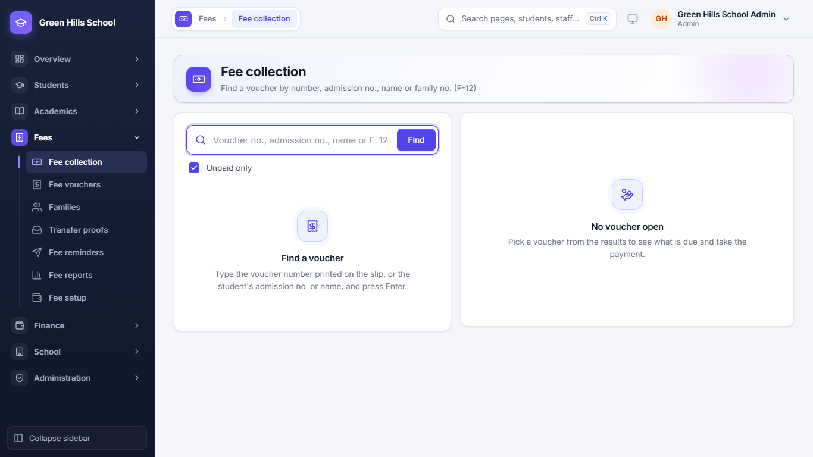
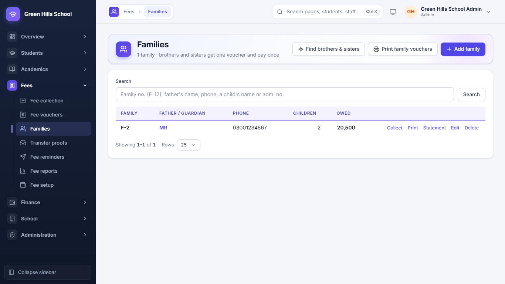
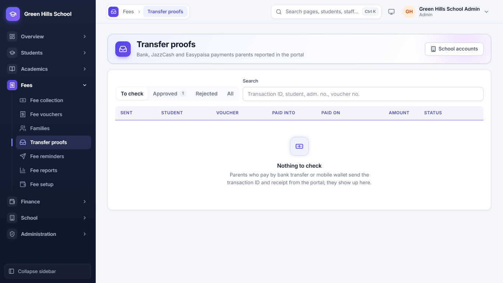
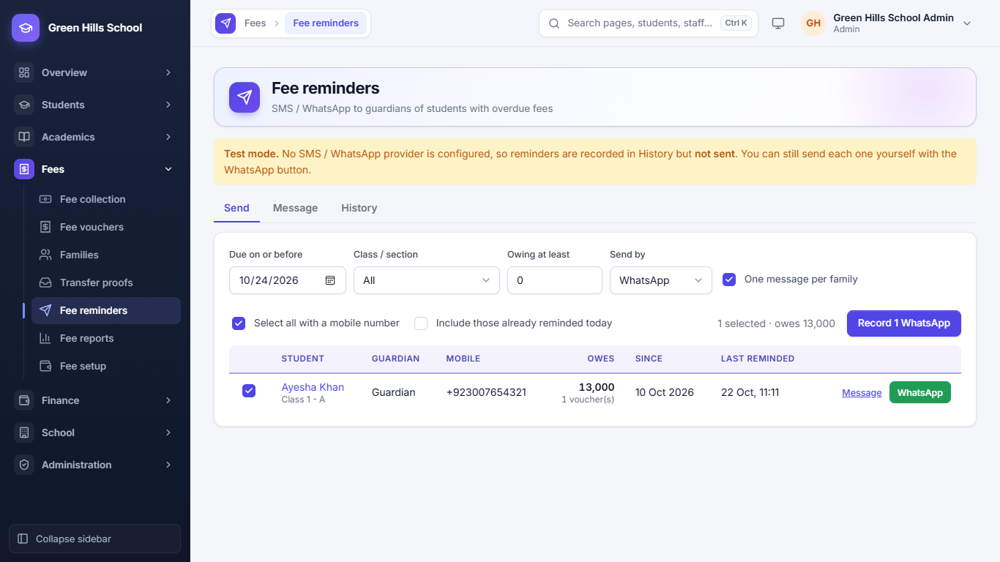
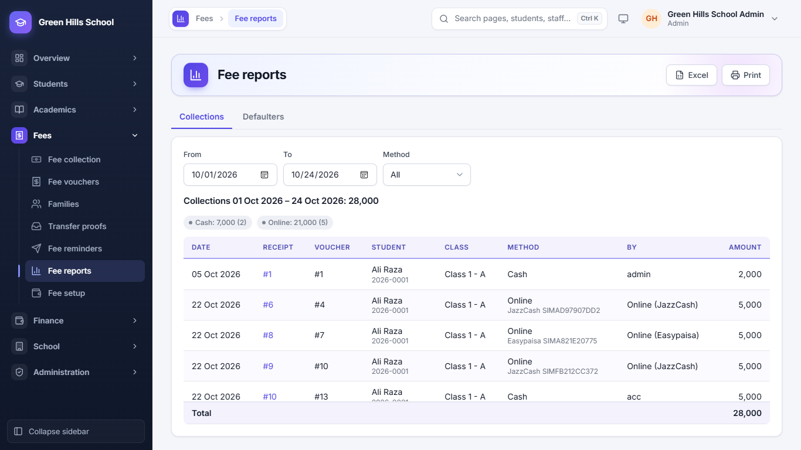

[User Guide](README.md) › Fees

# Fees

The usual monthly order is: set fees once (**Fee setup**) → make the month's vouchers → take payments at the counter
or from transfer proofs → send reminders to those who have not paid.

## Fee setup

Open **Fees → Fee setup**. It has three tabs:

- **Fee heads:** the kinds of fee, like Tuition (monthly), Computer (monthly) or Admission (one-time).
- **Fee structure:** how much each class pays for each head in the academic year. Leave a box empty if a class does
  not pay that head. Click **Save fees**. New amounts apply only to vouchers made after saving.
- **Sibling discount:** younger brothers and sisters pay less. For example, the 2nd child gets 20% off tuition. If a
  child also has their own concession, the bigger one is used, not both.

## Fee vouchers

**Fees → Fee vouchers** shows one month's vouchers. The cards at the top show the number of Vouchers, Billed,
Collected and Outstanding. Each row shows the voucher no., student, due date, payable, paid, balance and status (like
Paid, Unpaid or Cancelled). Tick several vouchers to cancel them together or send reminders to them. **Print these**
prints the vouchers in the list.

## Make the month's vouchers (Generate vouchers)

1. In Fee vouchers, click **Generate vouchers**.
2. Choose the **Month to bill** and the **Students** (whole school or one class).
3. Tick the fee heads to bill. Monthly heads are ticked already.
4. Enter the **Issue date**, **Due date** and **Late fine**. If the due date is not a school day, the app suggests the
   next school day.
5. Click **Generate**. Students who already have a voucher for that month are skipped, so it is safe to run again after
   new admissions.

**Family vouchers** prints all brothers' and sisters' vouchers of one family on one slip.

## Take a payment at the counter (Fee collection)

1. Open **Fees → Fee collection**.
2. Type the voucher no. printed on the slip, the admission no., the student's name or the family no. (like F-12), then
   press Enter.
3. Pick the voucher. The right side shows what is due today, including any late fine.
4. Enter the amount received and save. Print the receipt.

If you type a family no., one payment is shared across all the children's vouchers, oldest due first. The family gets
one receipt (like FR-7).

## Families

**Fees → Families** groups brothers and sisters. Click **Find brothers and sisters**: the app suggests children who
share the same guardian mobile number. Each family gets a number like F-12. **Statement** prints a family's full fee
record for the year.

## Transfer proofs

Many parents pay by bank transfer, JazzCash or Easypaisa. They send the transaction ID and a photo of the receipt from
the Portal. In **Fees → Transfer proofs**:

- **Approve:** the payment is saved on the voucher, with the transaction ID as the reference.
- **Reject:** write the reason; the parent sees it.

The parent gets an SMS either way. A red badge in the menu shows how many proofs are waiting. The school's bank and
wallet accounts are entered by the Admin or Principal.

## Fee reminders

**Fees → Fee reminders** sends an SMS or WhatsApp message to parents who still owe fees. Check the preview first, then
send. Children of one family are joined into one message, so a parent does not get several texts.

## Fee reports

**Fees → Fee reports** has two tabs. **Collections** lists every payment between two dates (From, To), with totals for
cash and online, and can be filtered by Method. **Defaulters** lists students who owe fees; you can filter by how many
months are unpaid, and managers can **Strike off** several defaulters at once. Use **Excel** or **Print** at the top
to download or print a report.

---

Previous: [Attendance and Holidays](04-attendance-and-holidays.md) · Next: [Exams, Timetable and more](06-academics.md)
