[User Guide](README.md) › Exams, Timetable, Homework, Certificates and Promotion

# Exams, Timetable, Homework, Certificates and Promotion

## Exams

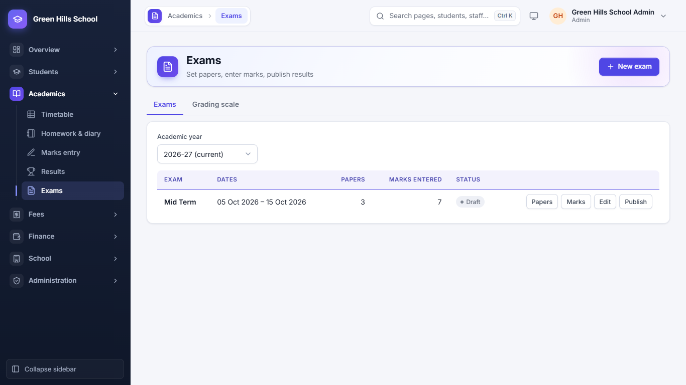

Open **Academics → Exams**.

1. Click **New exam** and enter its name and dates (for example Mid Term, 05–15 Oct).
2. Click **Papers** to add each subject's paper with its date and total marks.
3. Click **Marks** to enter marks (or use Marks entry, below).
4. When all marks are in, click **Publish**. Results and report cards can then be seen by staff and by parents in the
   Portal.

The **Grading scale** tab sets the grades (A+, A, B and so on) by percentage.

## Marks entry

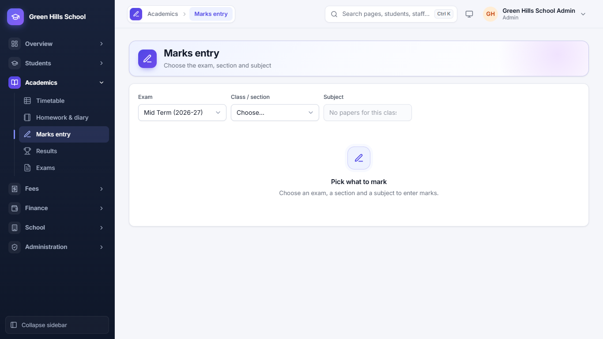

**Academics → Marks entry:** choose the exam, class and subject, then type each student's marks and save. A teacher
sees only their own classes and subjects.

## Results and report cards

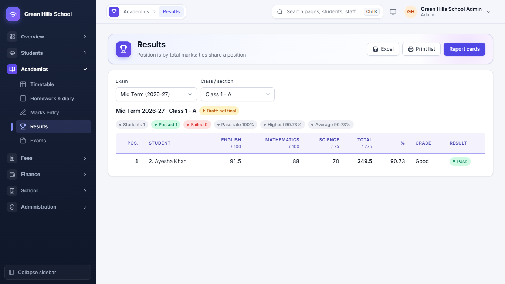

**Academics → Results** shows each student's total, percentage, grade and position in the class. From here you can
print report cards for the whole class. Choose the exam and class / section, then use the tabs:

- **Marks sheet:** every student's marks in every subject, with total, percentage, grade, result and position.
- **Subject analysis:** for each subject the class average, highest, lowest, pass rate and the subject topper; how
  many students got each grade; and the top of the class.
- **Term comparison:** each student's percentage in every published exam of the year side by side, with the rise or
  fall since the last one.

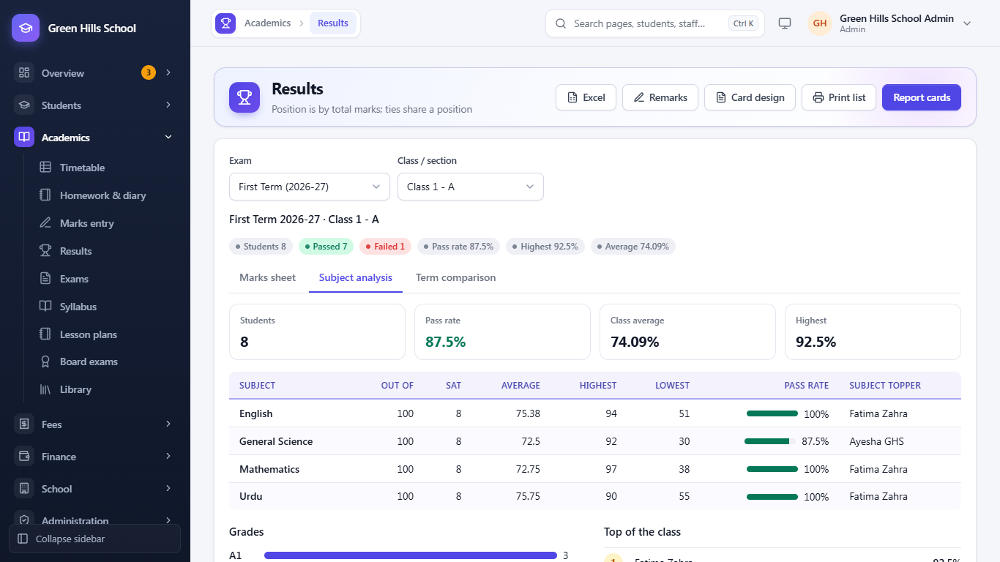

**Remarks:** the class teacher (or the Admin / Principal) writes a short remark for each student, like "Hard working;
needs to improve handwriting". It is printed on the report card.

**Card design** (Admin and Principal) sets how every report card looks, printed or in the parent portal:

- **Layout:** **Classic** (bordered A4 sheet, black and white), **Modern** (coloured header, rounded boxes) or
  **Compact** (two report cards on each A4 page).
- What to show: position in class, attendance, the class highest in each subject, earlier exams of the year (term
  comparison) and the grading scale.
- The **Principal's name** under the signature, and a **Note at the bottom** (for example "School reopens on 1 April").

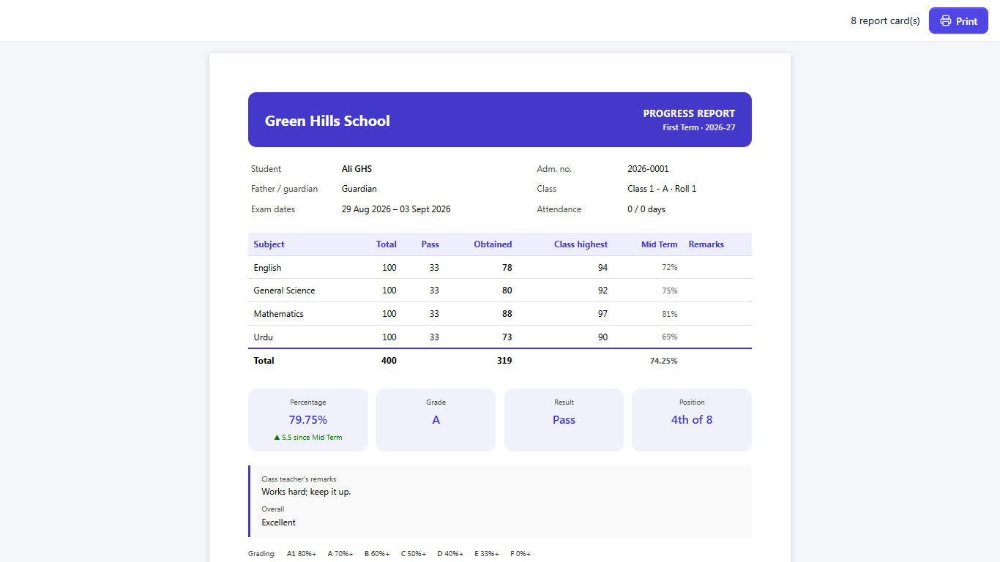

## Board exams

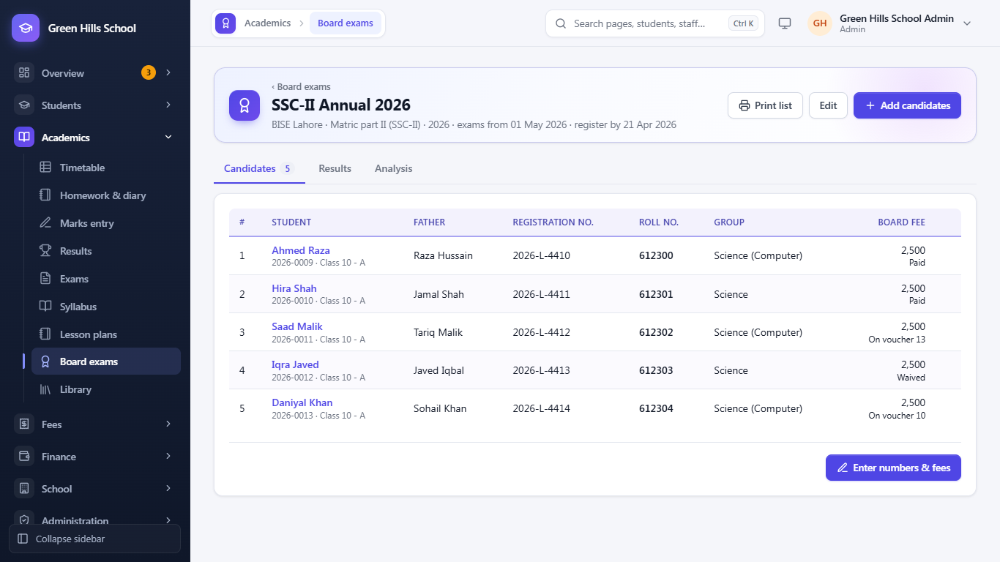

**Academics → Board exams** keeps track of students sitting Matric, Inter, O Level or A Level board exams. All staff
can look at it; the Admin and Principal make changes, and the fee office settles board fees.

1. Click **New board exam**. Enter the name (for example SSC-II Annual 2027), the **Board**, the **Level** (Matric
   Part 1 or 2, Inter Part 1 or 2, O Level, A Level or other), the **Year**, the **Register by** date, when the
   exams start, and the **Board fee (each)**.
2. On the **Candidates** tab, click **Add candidates** and choose a whole section or single students. Each one owes
   the board fee.
3. Click **Enter numbers & fees** to type each candidate's **Registration no.**, **Roll no.** and group. A fee can be
   changed for one student; a fee of 0 means nothing is owed. The same roll no. cannot be given twice.
4. Board fee: click **Paid** if the parent paid at the office, or **Waive**. Otherwise an unpaid board fee goes on the
   student's next fee voucher by itself, as "Board fee (SSC-II Annual 2027)".
5. When the result comes, open the **Results** tab and enter each candidate's marks (use **Same "out of" for all**),
   grade and result. Click **Save results**.
6. The **Analysis** tab shows how many appeared and passed, the pass percentage, the average marks, the grades, and
   the top positions.

Results stay hidden from parents until you click **Show to parents**. Then the parent portal shows the board exam,
the roll no. and the result on the child's **Board exams** tab. **Print list** prints the candidate list.

## Syllabus and lesson plans

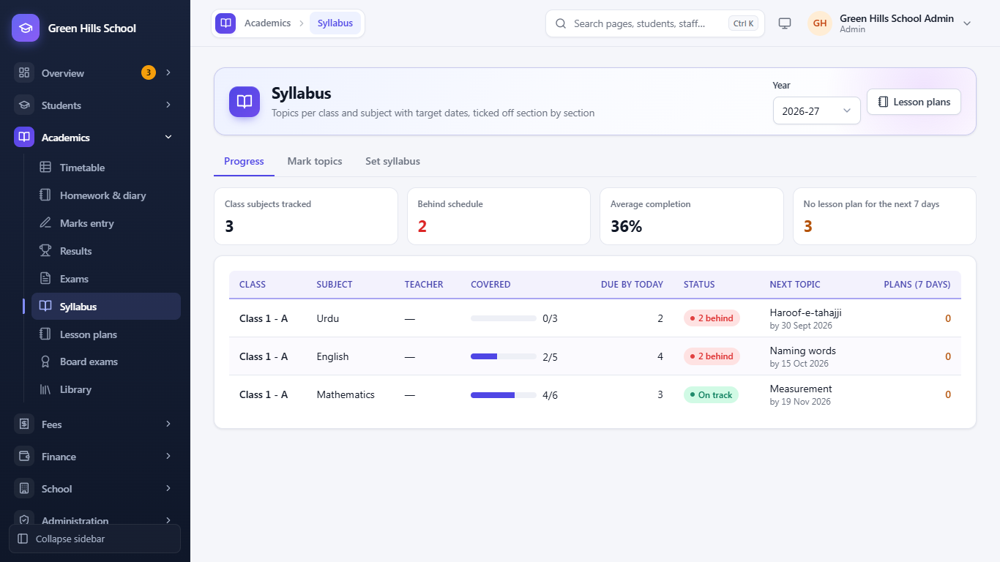

**Academics → Syllabus** shows how far each class has got with each subject. It has three tabs:

- **Set syllabus** (Admin and Principal): choose the year, class and subject, then list the topics in teaching order,
  each with a **Target** date to finish it. You can add them one by one or paste a list: one topic per line, with the
  target date after a | if you like (for example `Number system | 2026-05-15`). Click **Save syllabus**.
- **Mark topics:** the teacher chooses their class / section and subject and ticks each topic as it is taught, with
  the date. Click **Save progress**. A teacher can mark only the subjects they teach (from the timetable) or their own
  class.
- **Progress:** every class subject with the topics **Done**, the topics **Due by today**, the **Next topic** and the
  teacher. The most behind are at the top. The cards show how many class subjects are tracked, how many are **Behind
  schedule**, the **Average completion**, and how many have **No lesson plan for the next 7 days**. A teacher sees only
  their own classes.

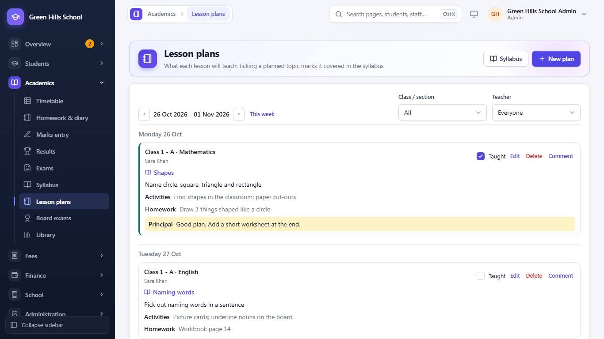

**Academics → Lesson plans** shows a week of plans (use ‹ and › or **This week**). Click **New plan** and enter the
**Date**, **Class / section**, **Subject**, the **Syllabus topic** it covers, **What the lesson will teach**,
**Activities / method** and **Homework**. After the lesson, tick **Taught** on the plan: its syllabus topic is marked
covered on that date. The Principal sees every teacher's plans and can add a **Comment** for the teacher, shown under the plan.

## Timetable

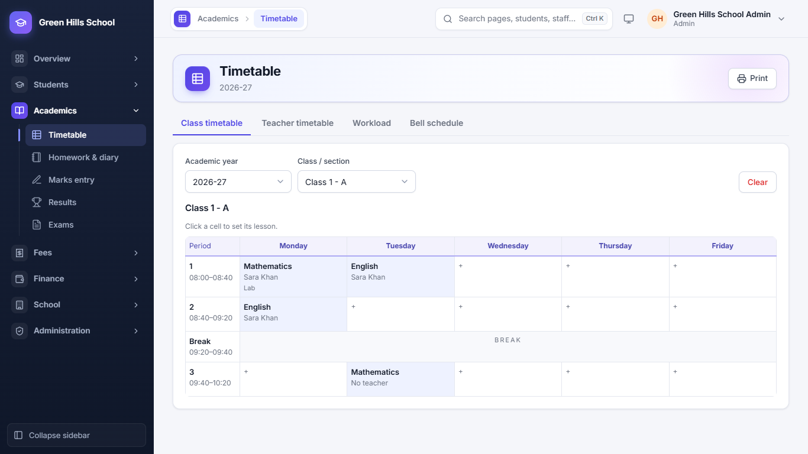

**Academics → Timetable** has four tabs:

- **Bell schedule:** set the periods and break times first.
- **Class timetable:** choose a class / section, then click a box to set the subject and teacher for that period. The
  app warns you if a teacher is already busy in another class at that time.
- **Teacher timetable:** one teacher's whole week.
- **Workload:** how many periods each teacher has.

Click **Print** to print a timetable. Teachers see their own timetable in **My timetable**.

## Homework and diary

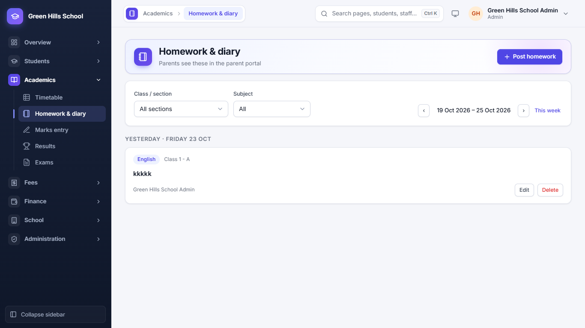

**Academics → Homework & diary:** choose a section and date, write the homework for each subject, and set a due date.
Parents see it in the Portal's Homework tab. Teachers can post only for their own classes.

## Certificates

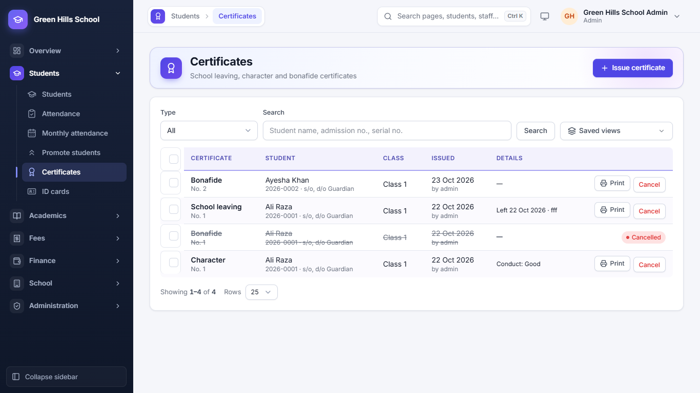

**Students → Certificates** lists the certificates already issued. To make a new one, open the student's page and
click **Issue certificate**. Choose School Leaving, Character or Bonafide, check the details and print. Each
certificate gets its own number and keeps the details as they were on the day it was issued.

## Promote students (end of the year)

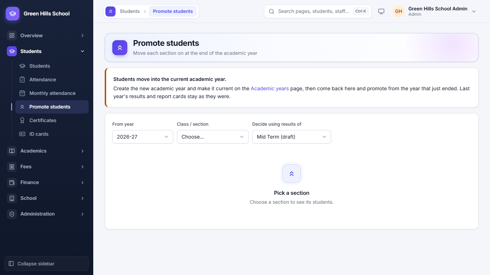

1. First go to **School → Academic years**, create the new year and make it current.
2. Open **Students → Promote students**.
3. Choose the **From year**, the **Class / section**, and the exam whose results decide promotion.
4. For each student choose **Promote**, **Repeat class**, **Graduate** or **Leaves school**. For Promote and Repeat
   class, pick the new section. Then save.

Last year's results and report cards stay as they were.

---

Previous: [Fees](05-fees.md) · Next: [Staff, Payroll and Expenses](07-staff-payroll-expenses.md)
