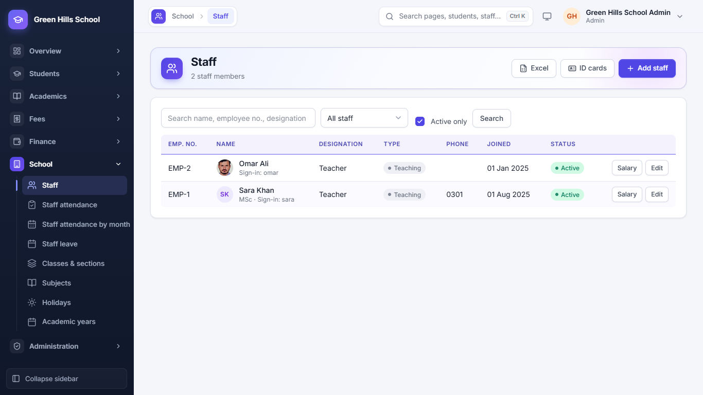
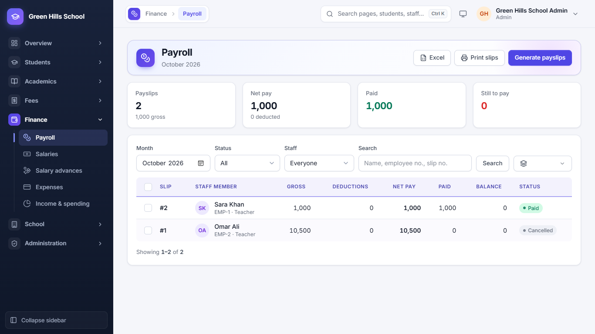
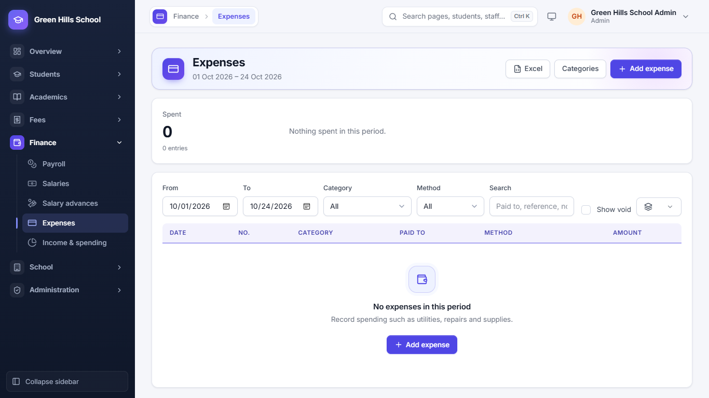
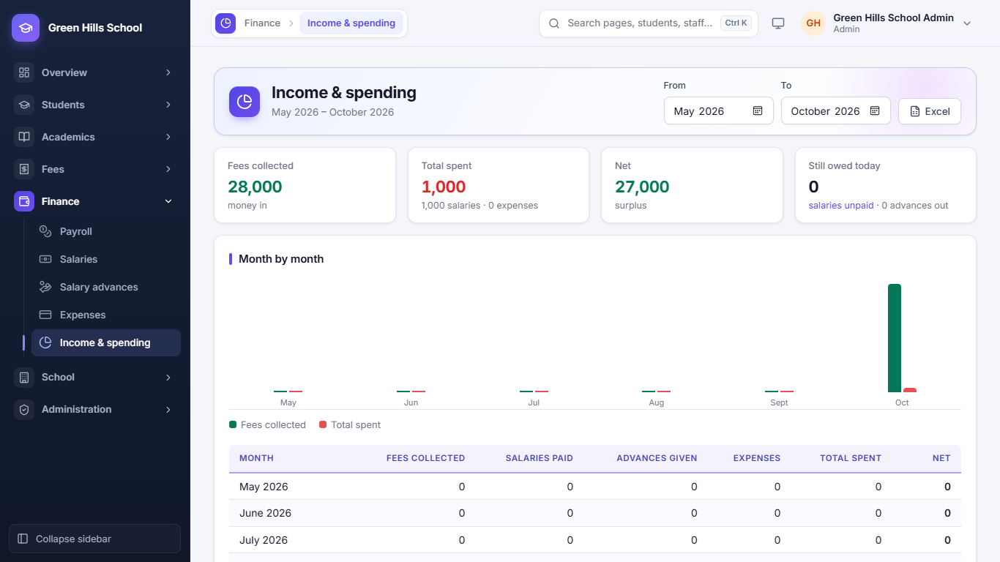

[User Guide](README.md) › Staff, Payroll and Expenses

# Staff, Payroll and Expenses

## Staff

Open **School → Staff**. It lists everyone who works at the school: teachers and other staff (like accountant, guard or
driver).

- **Add staff:** name, designation, type (Teaching or Non-teaching), phone, joining date and photo.
- **Salary:** set the person's basic pay and allowances. Payroll uses these amounts every month.
- **Edit:** change details, or mark the person inactive when they leave.
- A staff member who needs to use the app gets a login from **Administration → Users**; the list then shows their
  sign-in name.

## Payroll (monthly payslips)

1. Open **Finance → Payroll** and choose the month.
2. Click **Generate payslips**. Each payslip uses the person's salary, cuts absent days (if you choose that), and takes
   back salary advance instalments.
3. Check the list: Gross, Deductions, Net pay, Paid and Balance.
4. Mark a payslip paid when the salary is given. **Print slips** prints the payslips.

The cards at the top show the month's payslips, net pay, amount paid and amount still to pay. Staff can see their own
payslips in **My payslips**.

## Salary advances

**Finance → Salary advances:** record money given to staff before payday, and how much to take back each month.
Payroll takes it back by itself.

## Expenses

**Finance → Expenses:** record the school's spending, like electricity, rent, repairs or stationery. Choose a
category, enter the amount and date, and attach the bill if you have it.

## Income and spending

**Finance → Income & spending** puts fee income next to salaries and expenses, month by month, so you can see whether
the school is making or losing money.

---

Previous: [Exams, Timetable and more](06-academics.md) · Next: [School Groups](08-school-groups.md)
