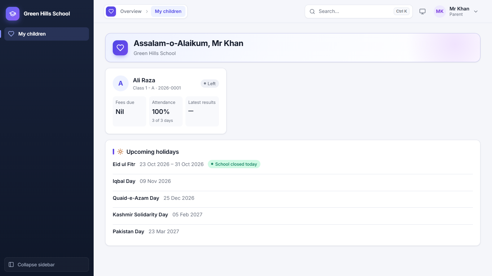
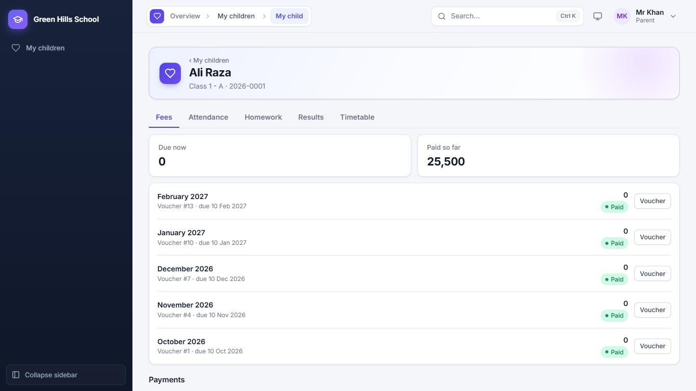
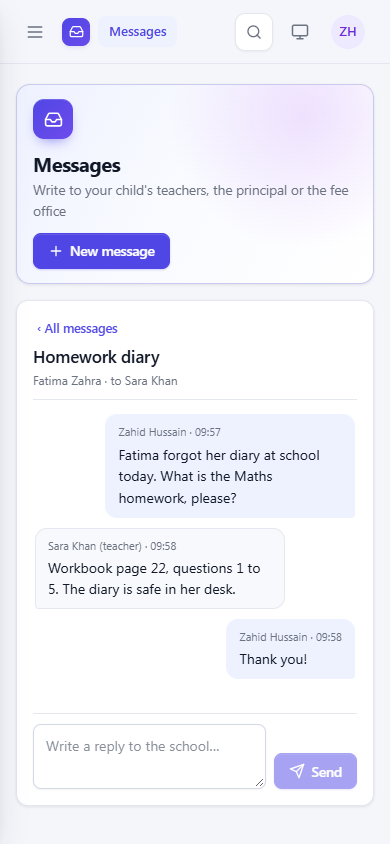
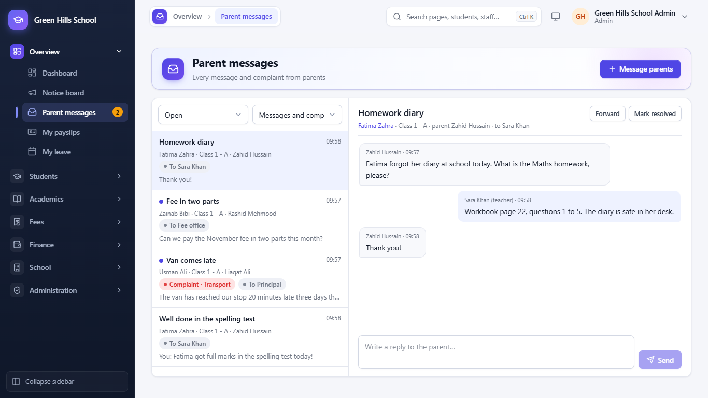
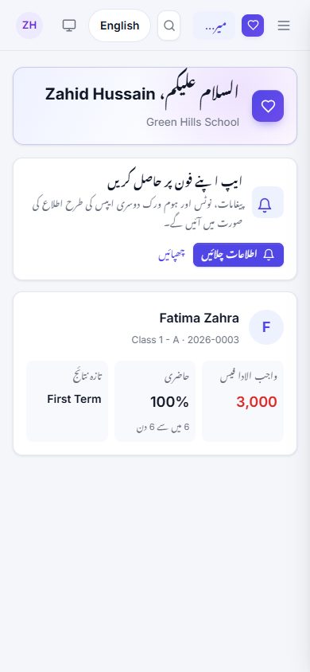
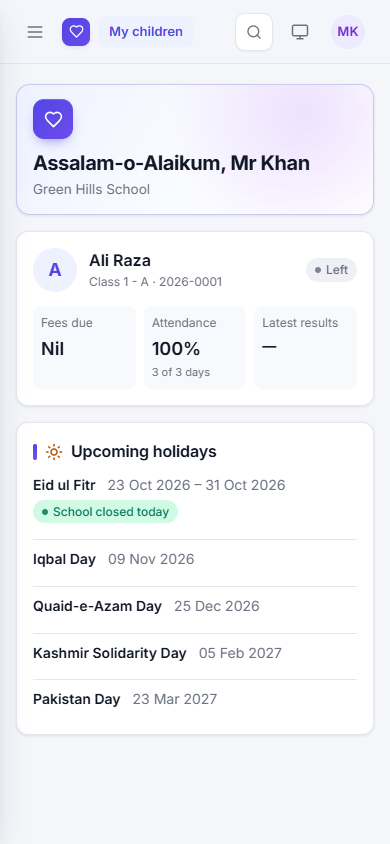

[User Guide](README.md) › Parent Portal

# Parent Portal

Parents sign in on the same login page with the username and password the school gives them (usually the guardian's
mobile number). At first login they must choose a new password.

## My children

The first page shows a card for each child: class, admission no., Fees due, Attendance (%) and Latest results.
Upcoming holidays are listed below. If the family has children at other branches of the same group, a box shows them
with an **Open** button to switch branch.

## A child's page

Click a child's card to open their page. It has these tabs:

- **Fees:** amount Due now and Paid so far, every month's voucher with its status, and past payments. Click
  **Voucher** to see or print it.
- **Attendance:** the month's present, absent, late and leave days.
- **Homework:** homework set by the teachers, with due dates.
- **Results:** exam results and report cards (after the school publishes them), and the date sheet of every
  upcoming exam, which can be printed.
- **Timetable:** the class's weekly timetable.
- **Transport:** only for a child on school transport: route, stop, times, fee and the driver's number. See
  [Transport](11-transport-library-notices.md#what-parents-see).
- **Library:** only for a child who has borrowed library books: each book, its return date, and any fine.
- **Board exams:** only for a child entered for a Matric, Inter, O or A Level board exam: the exam, registration and
  roll no., and the result once the school shows it.

**Message the school** on the child's page starts a message about that child (see below).

## Paying fees by bank transfer, JazzCash or Easypaisa

1. Pay the fee to one of the school's accounts (shown in the app).
2. On the voucher, click **I've paid**.
3. Choose the account you paid into, type the transaction ID (TID) and upload a photo of the receipt.
4. The school checks it. When it is approved, the voucher shows Paid and the parent gets an SMS. If it is rejected, the
   reason is shown.

A parent with two or more children can use **Pay for all your children** to send one proof for all of them.
**Pay online** appears only if the school has turned on an online payment gateway.

## Messages and complaints

Parents can write to the school from **Messages** in the portal menu, instead of calling or sending a note in the bag.

1. Click **New message**.
2. Choose the child it is **About**, and **To** whom: the class teacher, a subject teacher of the child's class, the
   Principal or the Fee office.
3. Choose **Message / question** or **Complaint**. A complaint has a category: teaching, behaviour, fees, transport,
   facilities, bullying or other.
4. Write the **Subject** and the **Message**, then **Send**.

Each message is a conversation: the school's replies appear under it, and a badge in the menu shows unread replies.
When the school marks it **Resolved**, the parent can still write again, which opens it again. A parent can start up
to 10 new conversations a day.

**At the school:** staff read and answer them in **Overview → Parent messages**. A teacher sees the messages sent to
them; the Accountant sees those for the Fee office; the Admin and Principal see all of them and can **Forward** one to
someone else (the parent's view does not change). Filter by Open / Resolved and by Messages / Complaints. **Mark
resolved** closes a conversation. **Message parents** lets staff start a conversation about a student; it goes to
every parent login of that child. A teacher can write only to parents in the sections whose attendance they mark.

## Urdu

The **اردو** button at the top of the portal shows the whole portal in Urdu, written right to left in Nastaliq: menus,
fees, attendance, results, report cards and vouchers. Click **English** to go back. The app remembers the choice on
that phone or computer.

Staff pages stay in English. On print pages (fee vouchers, report cards, date sheets) staff can choose **English** or
**اردو** in the toolbar before printing, for example to give a parent an Urdu voucher.

## On a mobile phone

The portal works on any phone browser. The menu folds away; tap the menu button at the top to open it.

**Install it as an app.** The first page shows a **Get the app on your phone** card:

- On Android (Chrome) and on a computer (Chrome, Edge), click **Install**. The school's app icon appears on the home
  screen and opens without the browser bar.
- On an iPhone, open the portal in Safari, tap Share, then **Add to Home Screen**. Open it from there.

Then click **Turn on notifications** and allow them. New messages from the school, notices and homework arrive as
notifications, like any other app. **Send a test** checks that they work. **Turn off** stops them on this phone;
signing out also stops them. Staff get the same card on their Dashboard, for parents' messages.

---

Previous: [School Groups](08-school-groups.md) · Next: [Users, Settings and Common Questions](10-settings-and-faq.md)
