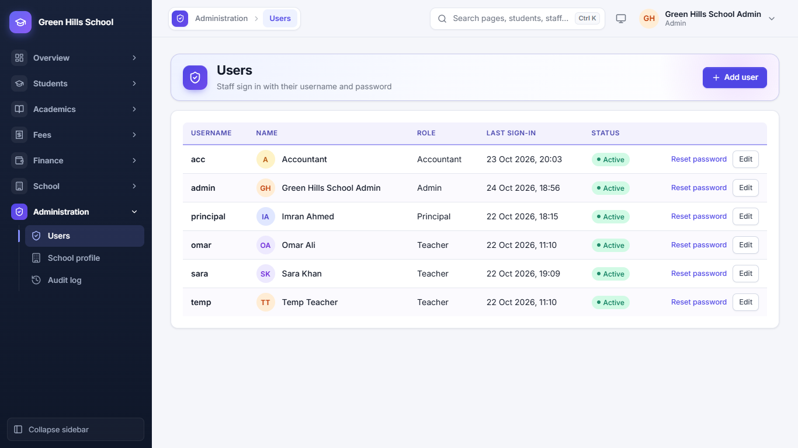
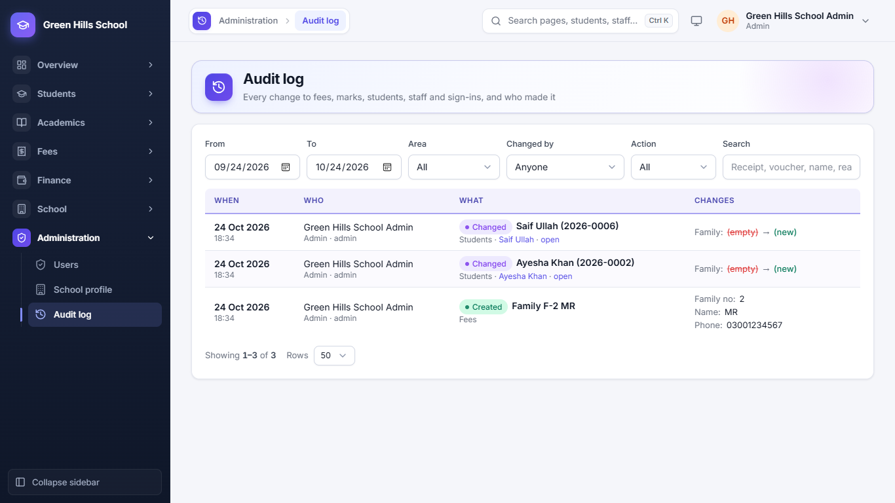
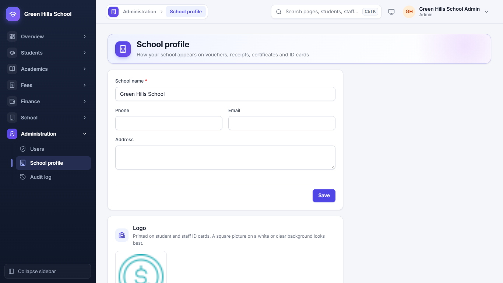
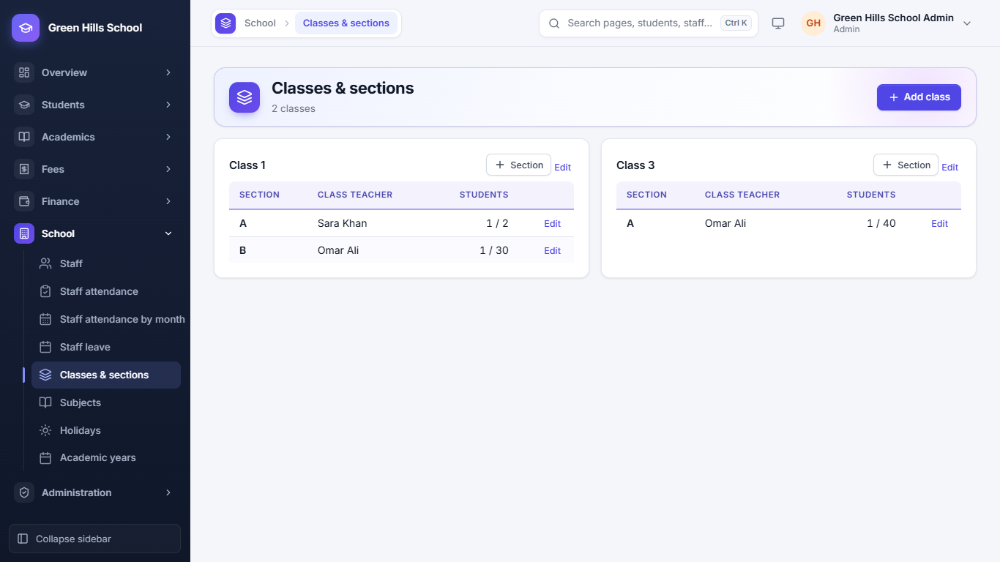
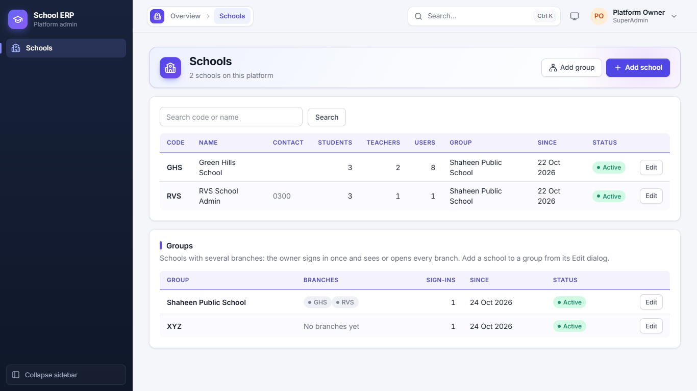

[User Guide](README.md) › Users, Audit Log, School Setup and Common Questions

# Users, Audit Log, School Setup and Common Questions

## Users

**Administration → Users** is where the Admin or Principal makes logins for staff. Enter the name, username, role
(Admin, Principal, Accountant or Teacher) and a password. A teacher's login is linked to their staff record so they see
only their own classes. You can reset a password or switch a login off here. Parent logins are made from the student's
page, not here.

## Audit log

**Administration → Audit log** records every change to fees, marks, students, staff and sign-ins: who did it, when,
and the old and new values. Filter by date, Area, Changed by and Action, or search for a receipt, voucher or name.

## School setup

Do these once when you start, and again at the start of each year:

1. **Administration → School profile:** school name, phone, email, address and logo. These are printed on vouchers,
   receipts, certificates and ID cards.
2. **School → Academic years:** add the year (for example 2026-27) and make it current.
3. **School → Classes & sections:** add classes (Class 1, Class 2 …) and their sections (A, B) with how many students
   fit.
4. **School → Subjects:** add the subjects taught.
5. **School → Staff**, then **Fees → Fee setup**, then admit students.

## Schools (Owner only)

The Owner (Super Admin) sees the **Schools** page. Here they add a new school with its first Admin login, switch a
school on or off, and put branches into a School Group.

## Common questions

- **I forgot my password.** Ask the Admin to reset it. Parents ask the school office.
- **A parent says they get no SMS.** Check the guardian phone number on the student's page.
- **Can I change a fee after vouchers are made?** Change it in Fee setup. Old vouchers keep their amounts; new vouchers
  use the new amount.
- **I made the vouchers twice.** That is fine: a student who already has a voucher for that month is skipped.
- **A student was marked absent by mistake.** Correct it within 15 minutes and the parent gets no SMS.
- **Who changed this record?** Open the Audit log, or the Audit log button on the student's page.
- **Can I use it on my phone?** Yes, every page works in a phone browser.

---

Previous: [Parent Portal](09-parent-portal.md) · Next: [Transport, Library and Notice board](11-transport-library-notices.md)
