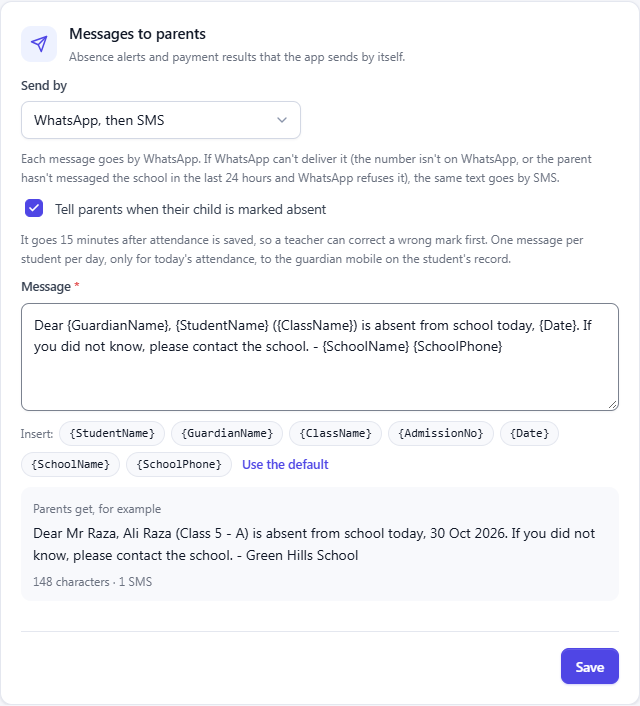
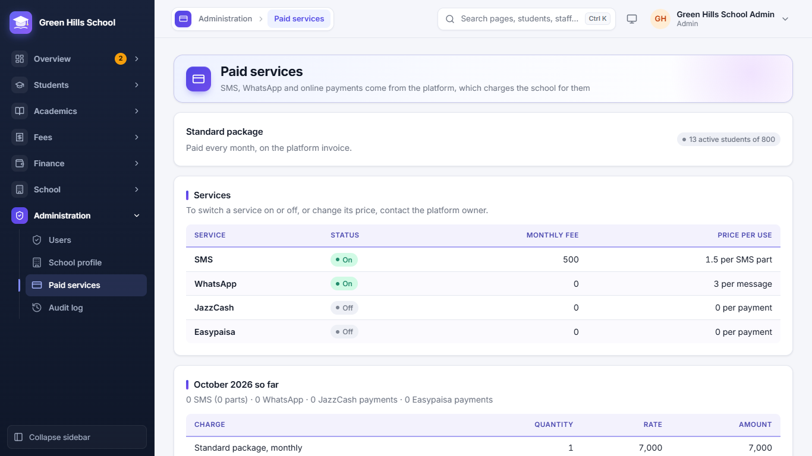

[User Guide](README.md) › Users, Audit Log, School Setup and Common Questions

# Users, Audit Log, School Setup and Common Questions

## Users

**Administration → Users** is where the Admin or Principal makes logins for staff. Enter the name, username, role
(Admin, Principal, Accountant or Teacher) and a password. A teacher's login is linked to their staff record so they see
only their own classes. You can reset a password or switch a login off here. Parent logins are made from the student's
page, not here.

## Audit log

**Administration → Audit log** records every change to fees, marks, students, staff and sign-ins: who did it, when,
and the old and new values. Filter by date, Area, Changed by and Action, or search for a receipt, voucher or name.

## School setup

Do these once when you start, and again at the start of each year:

1. **Administration → School profile:** school name, phone, email, address and logo. These are printed on vouchers,
   receipts, certificates and ID cards.
2. **School → Academic years:** add the year (for example 2026-27) and make it current.
3. **School → Classes & sections:** add classes (Class 1, Class 2 …) and their sections (A, B) with how many students
   fit.
4. **School → Subjects:** add the subjects taught.
5. **School → Staff**, then **Fees → Fee setup**, then admit students.

### Messages to parents

The **Messages to parents** card on the School profile sets how the app's own messages (absence alerts and payment
results) reach parents. **Send by** is **SMS**, **WhatsApp**, or **WhatsApp, then SMS**: each message goes by WhatsApp,
and if WhatsApp cannot deliver it (the number is not on WhatsApp, or the parent has not messaged the school in the last
24 hours and WhatsApp refuses it) the same text goes by SMS. Tick **Tell parents when their child is marked absent**
to send absence alerts, and change the wording of the message if you like; the preview shows its length.

## Paid services

SMS, WhatsApp and online payments (JazzCash, Easypaisa) cost money, so the platform owner switches them on for each
school and charges for them. **Administration → Paid services** (Admin and Principal) shows:

- The school's **package**, how it is paid (monthly, yearly or once) and the student limit, like "13 active students
  of 800". When the limit is reached, no more students can be admitted, imported or promoted into the school until
  the owner moves it to a bigger package.
- Each **service**, whether it is on, its monthly fee and its price per use (per SMS part, per WhatsApp message, per
  payment).
- **This month so far:** how many messages and payments were used and what they cost.
- **Invoices** from the platform, which can be printed.

To switch a service on or off, or to change a price, contact the platform owner. See
[For the platform owner](12-platform-owner.md).

## Schools (Owner only)

The Owner (Super Admin) sees the **Schools** page. Here they add a new school with its first Admin login, switch a
school on or off, and put branches into a School Group. Everything else the owner does is in
[For the platform owner](12-platform-owner.md).

## Common questions

- **I forgot my password.** Ask the Admin to reset it. Parents ask the school office.
- **A parent says they get no SMS.** Check the guardian phone number on the student's page.
- **Can I change a fee after vouchers are made?** Change it in Fee setup. Old vouchers keep their amounts; new vouchers
  use the new amount.
- **I made the vouchers twice.** That is fine: a student who already has a voucher for that month is skipped.
- **A student was marked absent by mistake.** Correct it within 15 minutes and the parent gets no SMS.
- **Who changed this record?** Open the Audit log, or the Audit log button on the student's page.
- **Can I use it on my phone?** Yes, every page works in a phone browser, and it can be installed as an app with
  notifications (see [On a mobile phone](09-parent-portal.md#on-a-mobile-phone)).
- **A parent gets no WhatsApp message.** If the number is not on WhatsApp, choose **WhatsApp, then SMS** so the SMS
  goes instead. The Fee reminders History shows what happened to each message.
- **A fingerprint machine is not marking attendance.** Check **Last heard from** on Attendance devices, and that the
  person is enrolled on the machine under the PIN shown on the Fingerprint PINs tab.
- **SMS or WhatsApp is not going at all.** Look at **Administration → Paid services**: the service may be off for
  your school. Ask the platform owner to switch it on.
- **"Student limit reached" when admitting.** The school's package allows only so many active students. Strike off
  students who have left, or ask the platform owner for a bigger package.
- **A bank payment was not matched.** In Match bank statement, type the voucher no. on that line and Record it. Ask
  parents to write V- and the voucher no. in the purpose of the transfer.
- **A uniform sold on fees is not on the voucher.** It goes on the next voucher generated for that student. If it
  was added to a voucher that was later cancelled, it goes on the next one.

---

Previous: [Parent Portal](09-parent-portal.md) · Next: [Transport, Library and Notice board](11-transport-library-notices.md)
