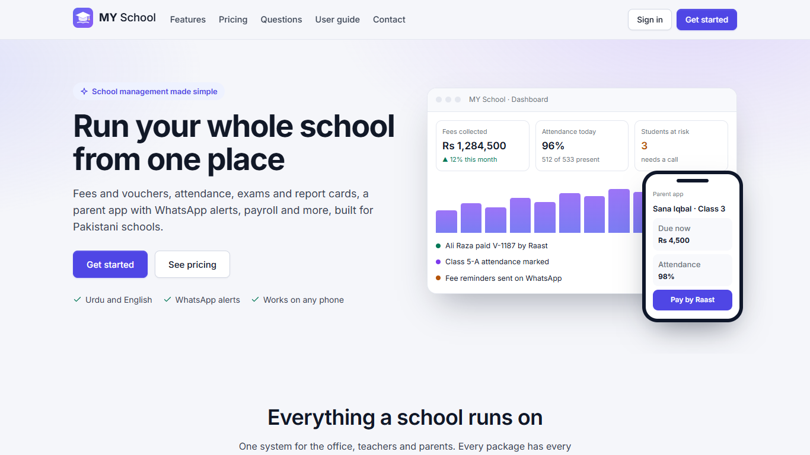
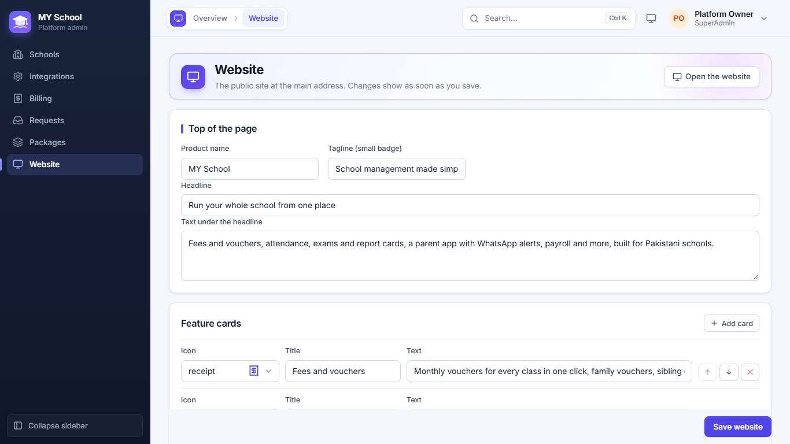
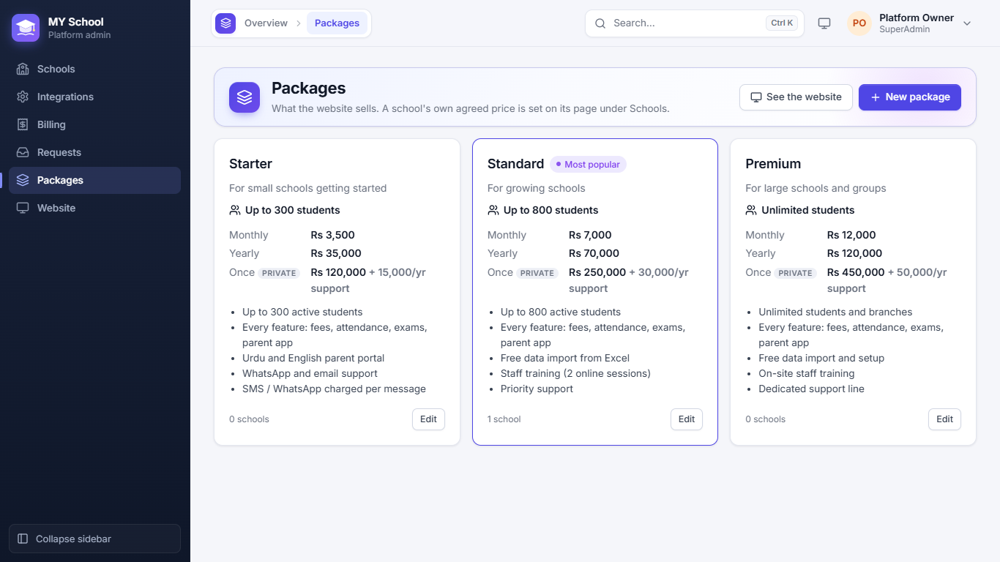
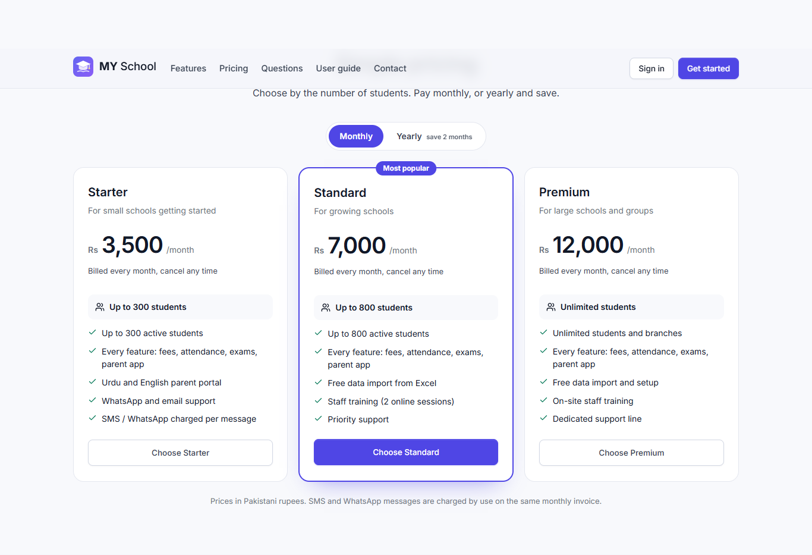
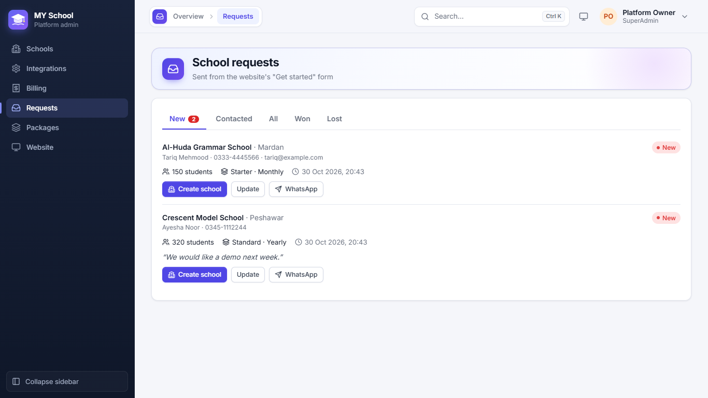
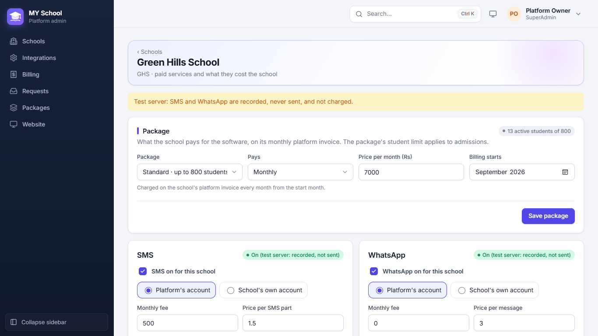
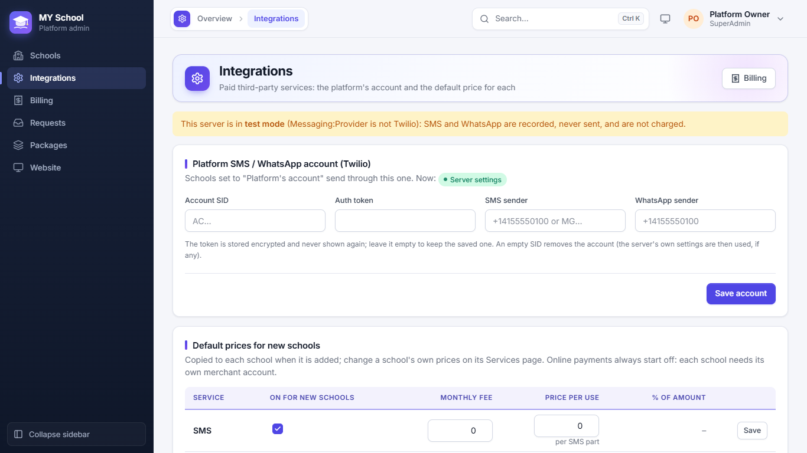
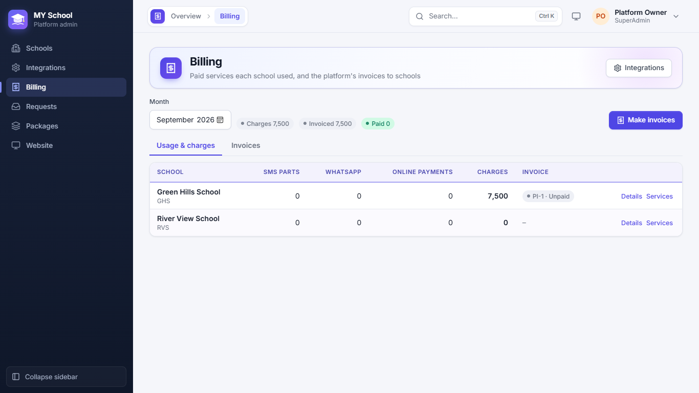

[User Guide](README.md) › For the platform owner

# For the platform owner

This chapter is for the Owner (Super Admin) who runs MY School and sells it to schools. Schools never see these pages.
The owner's menu has **Schools**, **Integrations**, **Billing**, **Requests**, **Packages** and **Website**.

## The website

The main address of the app (without /login) opens the public website: what MY School does, the packages with their
prices, common questions and a **Get started** form. Schools that already use the app click **Sign in**.

**Website** changes the words on that page: the product name, tagline, headline and the text under it, the feature
cards (each with an icon, title and text; move them up or down), the questions and answers, and the phone, WhatsApp
and email for contact. Click **Save website**: the change shows at once. **Open the website** shows it. When there are
no questions, that part of the page is hidden.

## Packages

**Packages** are what the website sells, for example Starter (up to 300 students), Standard (up to 800) and Premium
(no limit). Each has a short line, the student limit, the price **Monthly** and **Yearly**, a one-time (**Once**)
price with a yearly support fee, and a list of what it includes. Tick **Most popular** to mark one on the website.

The one-time price is **private**: it is never shown on the website, only to you, for schools that ask to buy
outright. A package can be hidden from the website without changing the schools already on it.

## Requests from new schools

When a school fills in **Get started** on the website, it arrives in **Requests** (the menu shows how many are new):
the school's name and city, the contact person, phone and email, how many students, which package and how they want
to pay, and their message.

- **WhatsApp** opens a chat with the contact person.
- **Update** moves the request to **Contacted** or **Lost** and keeps your note.
- **Create school** opens the new-school form already filled in with the request; when the school is saved, the
  request is marked **Won**.

The form accepts only a few requests a minute from the same place, to stop spam.

## A school's package and services

On **Schools**, click **Services** on a school. Its page has:

- **Package:** the package, how the school pays (**Monthly**, **Yearly** or **Once**), the price agreed with this
  school (it can differ from the website) and the month billing starts. A one-time sale also has a yearly support fee.
  The package's student limit applies to admissions: "13 active students of 800".
- **SMS** and **WhatsApp:** on or off for this school, sent through the **Platform's account** or the **School's own
  account** (their own Twilio account), the monthly fee and the price per SMS part / per message.
- **JazzCash** and **Easypaisa:** on or off, the school's own merchant details, the monthly fee and the charge per
  payment (a fixed amount and / or a % of the amount).

A yellow line at the top says when the server is a **test server**: messages are recorded but never sent, and not
charged.

## Integrations

**Integrations** holds the platform's own **SMS / WhatsApp account (Twilio)**: Account SID, Auth token, SMS sender and
WhatsApp sender. Schools set to "Platform's account" send through it. The token is stored encrypted and never shown
again; leave it empty to keep the saved one.

**Default prices for new schools** are copied to each school when it is added (on or off, monthly fee, price per use,
% of amount). Change one school's prices on its Services page. Online payments always start off, because each school
needs its own merchant account.

## Billing

**Billing** shows, for the chosen month, how many SMS parts, WhatsApp messages and online payments each school used,
and what it comes to with the monthly fees and the package. **Details** lists every charge; **Services** opens the
school's page.

Click **Make invoices** to make that month's invoice for every school (PI-1, PI-2 …). The **Invoices** tab lists them;
print one to send to the school, and mark it **Paid** when the money comes. Schools see their invoices under
**Administration → Paid services**.

---

Previous: [Transport, Library and Notice board](11-transport-library-notices.md) · Back to the [User Guide](README.md)
