[User Guide](README.md) › For the platform owner

# For the platform owner

This chapter is for the Owner (Super Admin) who runs School Hisaab and sells it to schools. Schools never see these pages.
The owner's menu has **Schools**, **Integrations**, **Billing**, **Requests**, **Packages** and **Website**.

## The website

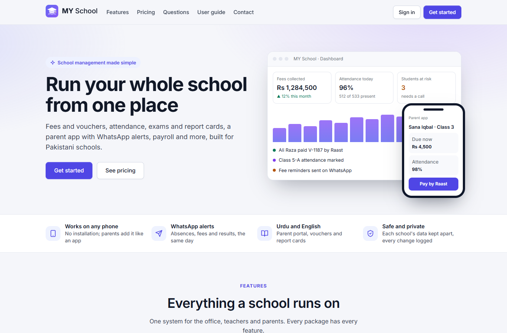

The main address of the app (without /login) opens the public website. From the top down it has: the headline, a
strip of short highlights, the feature cards, **How it works** in numbered steps, the packages with their prices, a
demo band with a button, common questions, and a contact card with the **Get started** form. Schools that already use
the app click **Sign in**.

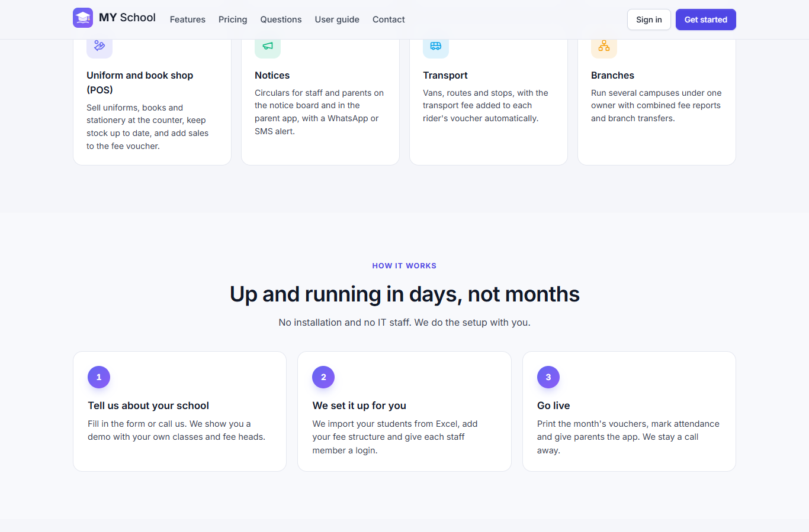

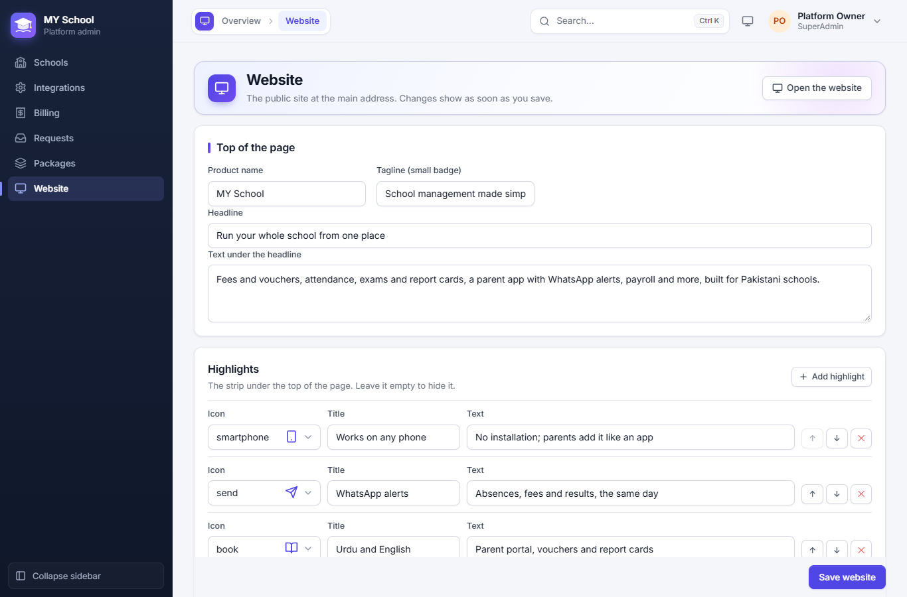

**Website** changes every word on that page, part by part, in the same order as the page:

- **Top of the page**: the product name, the tagline (the small badge), the headline and the text under it.
- **Highlights**: the strip under the top. Each has an icon, a title and a short text.
- **Feature cards**: each with an icon, a title and a text.
- **How it works**: the numbered steps, each with a title and a text.
- **Demo band**: its title, text and button words.
- **Questions**: the questions and their answers.
- **Contact and links**: the contact person and their role (like "Sales and support"), phone, WhatsApp number, the sales email
  (sales@schoolhisaab.com) and the support email for schools already using it (support@schoolhisaab.com), the address, the user guide link and the note at the foot of the page.

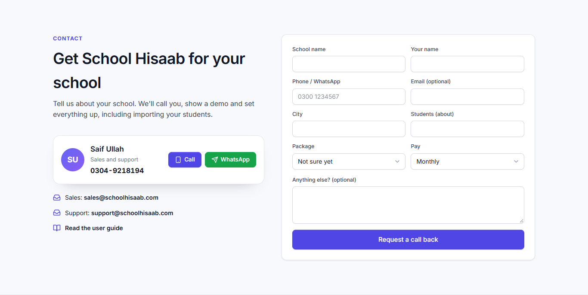

In the lists (highlights, cards, steps, questions), **Add highlight** / **Add card** / **Add step** / **Add question** makes a new one, the arrows move one up or down and ✕
removes it. A list left empty is hidden on the website, and so are the questions when there are none. Click
**Save website**: the change shows at once. **Open the website** shows it.

## Packages

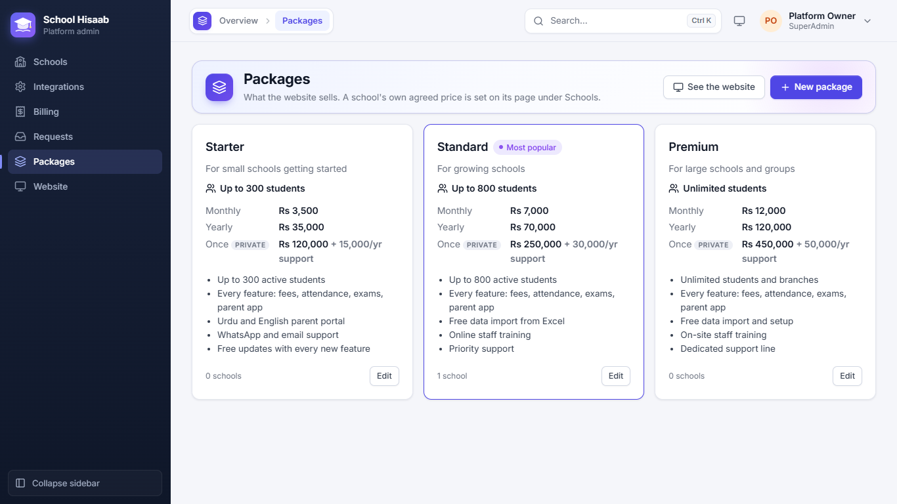

**Packages** are what the website sells, for example Starter (up to 300 students), Standard (up to 800) and Premium
(no limit). Each has a short line, the student limit, the price **Monthly** and **Yearly**, a one-time (**Once**)
price with a yearly support fee, and a list of what it includes. Tick **Most popular** to mark one on the website.

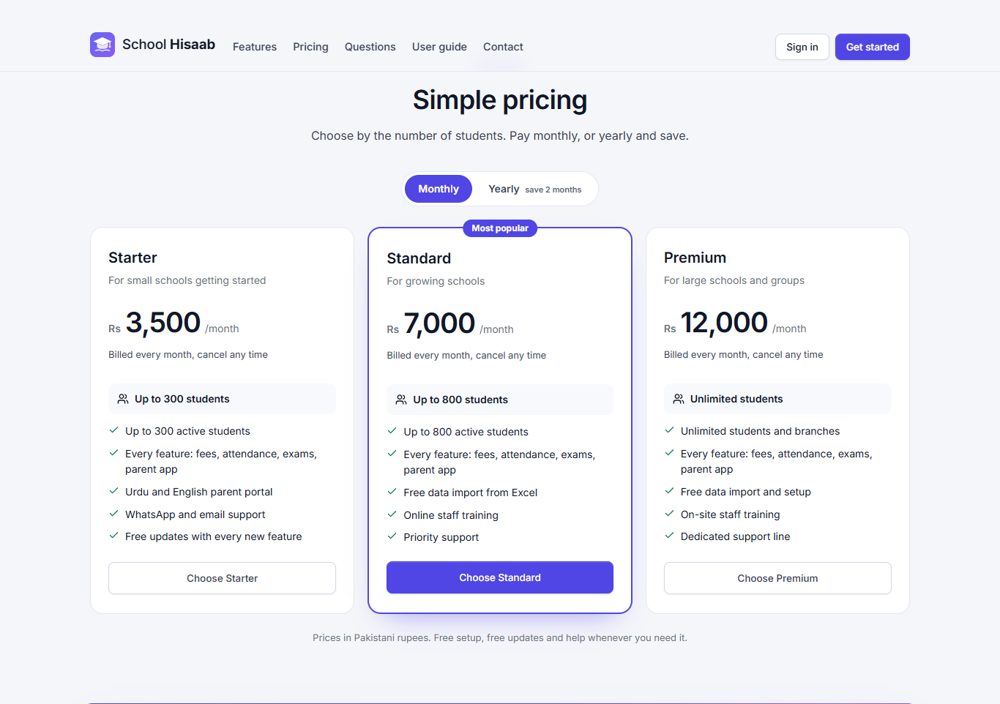

The one-time price is **private**: it is never shown on the website, only to you, for schools that ask to buy
outright. A package can be hidden from the website without changing the schools already on it.

## Requests from new schools

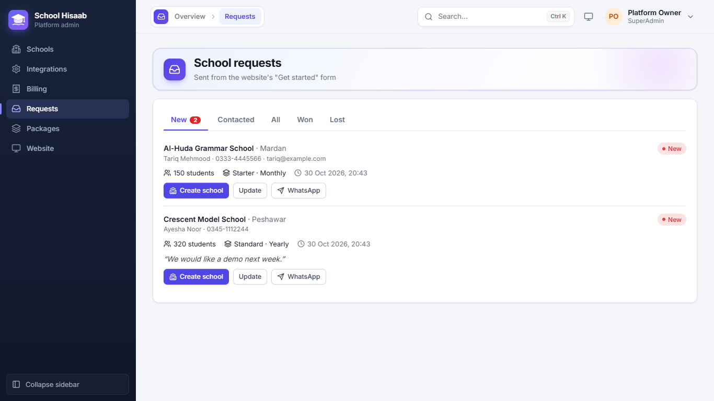

When a school fills in **Get started** on the website, it arrives in **Requests** (the menu shows how many are new):
the school's name and city, the contact person, phone and email, how many students, which package and how they want
to pay, and their message.

- **WhatsApp** opens a chat with the contact person.
- **Update** moves the request to **Contacted** or **Lost** and keeps your note.
- **Create school** opens the new-school form already filled in with the request; when the school is saved, the
  request is marked **Won**.

The form accepts only a few requests a minute from the same place, to stop spam.

## A school's package and services

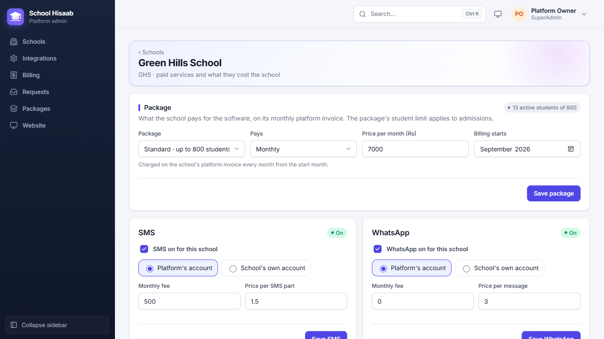

On **Schools**, click **Services** on a school. Its page has:

- **Package:** the package, how the school pays (**Monthly**, **Yearly** or **Once**), the price agreed with this
  school (it can differ from the website) and the month billing starts. A one-time sale also has a yearly support fee.
  The package's student limit applies to admissions: "13 active students of 800".
- **SMS** and **WhatsApp:** on or off for this school, sent through the **Platform's account** or the **School's own
  account** (their own Twilio account), the monthly fee and the price per SMS part / per message.
- **JazzCash** and **Easypaisa:** on or off, the school's own merchant details, the monthly fee and the charge per
  payment (a fixed amount and / or a % of the amount).
- **School website:** on or off, the monthly fee and the school's own domain (optional).

### School website and its own domain

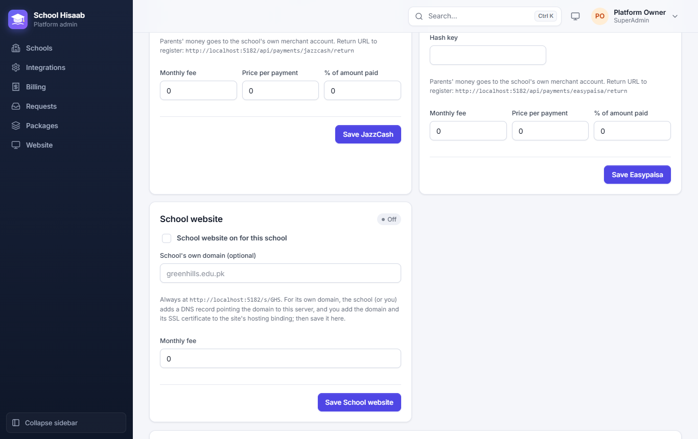

Tick **School website on for this school**, enter the monthly fee and click **Save School website**. The school can
then publish its site from **School → School website** (see [School website](10-settings-and-faq.md#school-website));
it is always at `<your address>/s/CODE`. Switching the service off takes the site down at once; the school's words and
photos are kept.

For the school's **own domain** (greenhills.edu.pk):

1. The school (or you) adds a DNS record at its domain company: an **A record** to your server's IP address (or a
   **CNAME** to your app's address), for both `greenhills.edu.pk` and `www.greenhills.edu.pk`.
2. On the server, add the domain to the site's hosting binding (in IIS: **Bindings → Add**, host name
   `greenhills.edu.pk`, and again for `www.`) with an SSL certificate for it (for example a free Let's Encrypt one).
3. Enter the domain on the school's Services page and save. A domain can belong to one school only.

Visitors to that domain then see the school's website on the front page; the ERP itself still opens at `/login`.

## Integrations

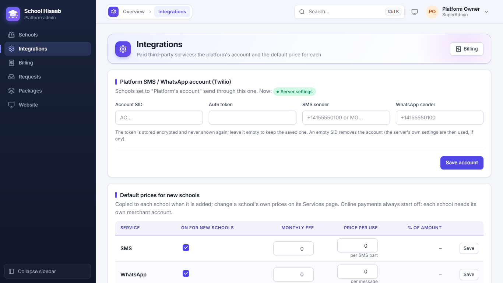

**Integrations** holds the platform's own **SMS / WhatsApp account (Twilio)**: Account SID, Auth token, SMS sender and
WhatsApp sender. Schools set to "Platform's account" send through it. The token is stored encrypted and never shown
again; leave it empty to keep the saved one.

**Default prices for new schools** are copied to each school when it is added (on or off, monthly fee, price per use,
% of amount). Change one school's prices on its Services page. Online payments always start off, because each school
needs its own merchant account.

## Billing

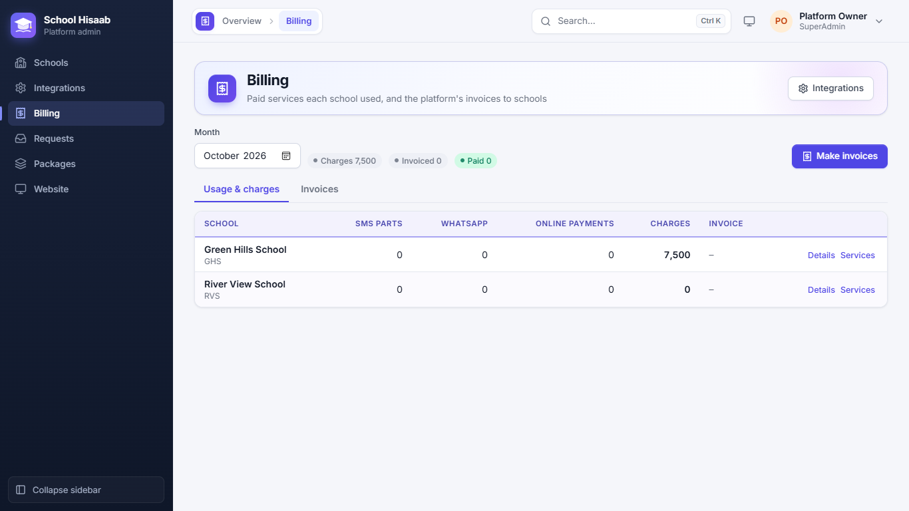

**Billing** shows, for the chosen month, how many SMS parts, WhatsApp messages and online payments each school used,
and what it comes to with the monthly fees and the package. **Details** lists every charge; **Services** opens the
school's page.

Click **Make invoices** to make that month's invoice for every school (PI-1, PI-2 …). The **Invoices** tab lists them;
print one to send to the school, and mark it **Paid** when the money comes. Schools see their invoices under
**Administration → Paid services**.

---

Previous: [Transport, Library and Notice board](11-transport-library-notices.md) · Back to the [User Guide](README.md)
